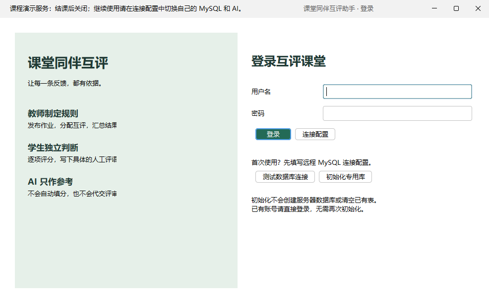
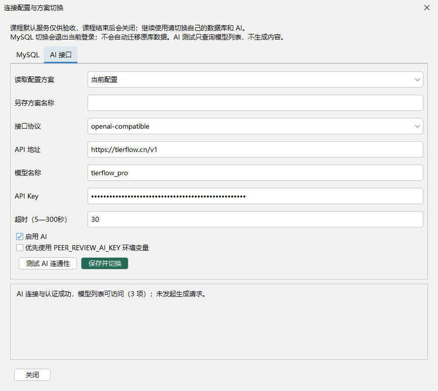
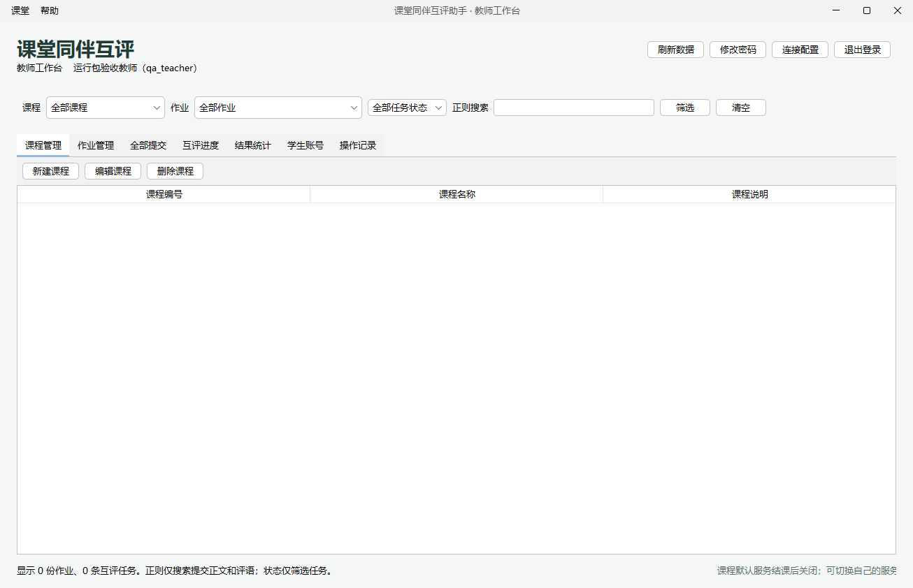

# 可运行程序、独立环境与配置切换验收

日期：2026-10-16。结果：**PASS**。

## 1. 本次交付

- 可运行含依赖 JAR：`target/peer-review-assistant.jar`。
- 完整 Maven 源码分发：`target/peer-review-assistant-submission.zip`，不含真实数据库密码、API Key 或本机配置。
- Windows x64 便携运行包：`peer-review-assistant-1.0.0-windows-x64-20261016-184420.zip`，约 72.55 MiB，包含 Java 17、运行脚本、专用课程默认配置、CA 信任库和使用说明。

便携包解压后双击 run.cmd，不需要 IDEA、Maven 或系统 Java。课程演示数据公开共享，服务结课后由维护者关闭；客户端始终保留自己的服务配置入口。

真实演示凭据仅在显式制作的运行包内，不放入 Git 或源码包。没有把 root、原开发数据库或个人开发配置复制到发行包。

## 2. 测试与运行环境

- 全量默认测试：**95 项，0 失败、0 错误、0 跳过**。
- 测试 JVM：**Temurin 17.0.20.1**，不是只设置 --release 17 后用 Java 25 跑测试。
- 实际启动方式：解压最终 ZIP 后，用其中的 runtime/bin/java.exe 执行真实 `-jar bin/peer-review-assistant.jar`。
- PATH 只有 Windows System32；JAVA_HOME 为空，另对 run.cmd 使用无效 JAVA_HOME 做优先级复验。
- 工作目录为另建的空目录，user.home 指向隔离目录；没有 config/application.properties，以包内课程默认配置启动。
- 不使用 IDEA、Maven、系统 Java、开发目录 classpath 或开发配置。
- UI 验收通过测试专用 Java instrumentation agent 驱动实际窗口事件，agent 不在用户运行包内。

**边界说明：这是本机隔离目录和运行环境验收，不是新装 Windows 虚拟机或另一台物理电脑。** 系统字体、操作系统及网络仍来自本机，不能宣称穷尽所有 Windows/硬件环境。

## 3. 实际窗口检查

| 编号 | 检查 | 结果 |
|---|---|---|
| RUN-01 | 实际 JAR 从独立目录启动，包内 Java 17 可用，课程结课关闭提示可见 | PASS |
| RUN-02 | 使用独立演示 MySQL 的教师账号登录，正常读取课程数据 | PASS |
| CFG-01 | 在配置页测试 API、保存 API 方案、切换成功；仅 GET 模型列表，不生成内容 | PASS |
| CFG-02 | 无效 MySQL 草稿连接失败后，活动配置文件 SHA-256 不变 | PASS |
| CFG-03 | 切换管理员只创建空库、没有任何业务表的 MySQL，产品自动建齐表并退出旧登录 | PASS |
| CFG-04 | 对自动建表后的新库，从产品窗口初始化自己的教师并登录 | PASS |
| CFG-05 | 从方案下拉框恢复课程默认数据库，要求重新登录，旧数据不自动迁移 | PASS |
| CFG-06 | 重读当前设置和两类私有方案，确认独立持久化；发布原 ZIP 未被测试更改 | PASS |

以上为 8 个场景检查，另有 FINAL 汇总记录，不把汇总算成额外功能测试，也不与 95 项 JUnit 数量混算。

## 4. 额外真实数据库与启动器检查

- 使用仅限指定专用库的设置账号，产品成功创建**此前不存在的数据库**以及全部 10 张表。
- 表结构准备没有暗中插入教师或作业；自己的教师账号由使用者显式初始化。
- 把测试库版本字段默认值改为不兼容后，结构检查拒绝切换，没有删除或重建表。
- run.cmd 在无效 JAVA_HOME、无系统 Java 的 PATH 和无关工作目录下仍优先使用包内运行时，`--version` 正常。
- 临时验收库及具有 DDL 权限的测试账号已在成功核对后删除；默认演示库、开发库和原业务记录保留。

证据：[数据库准备](additional-schema.txt)、[启动器复验](launcher-smoke.txt)、[服务端核对与清理](server-cleanup.txt)。

## 5. 默认服务和后续自备配置

默认服务只用于本课程验收，结课后由维护者撤销演示数据库账号和 API Key；没有对客户端设置日期锁，也不会禁用使用者自己的配置。

MySQL 切换遵循：测试草稿→检查字段/类型/主键/唯一约束/必要外键→创建缺失专用库或表、补已知安全字段→再次检查→保存并切换→退出旧登录。

未知冲突、必填字段差异、版本默认值不符、必要级联约束缺失时拒绝切换。不会为“结构一致”执行 DROP/TRUNCATE 或自动删已有业务数据。DDL 不是跨全部语句的事务，权限中断后可在修复后重试。

API 支持 Anthropic 和 OpenAI 兼容协议。切换测试是带认证的模型列表 GET，不发送作业、不生成评语，不等于模型推理能力或评语质量验证。

详见 [运行与配置说明](../../运行与配置.md)。

## 6. 截图

### 首次运行提示

### AI 仅测试连通性

### 自备数据库的教师登录

其他证据：[默认登录](02-default-teacher.png)、[切库后退出登录](04-new-database-logged-out.png)、[恢复默认](06-return-to-default.png)。

## 7. 二进制与原始记录

- [最终 ZIP/JAR SHA-256 与 Java 17 测试摘要](release-verification.json)
- [原始窗口检查记录](checks.txt)
- [隔离环境参数](environment.json)
- [默认服务准备与只读 API 验证](default-services.txt)

验收中实际运行的 JAR 与最终 ZIP 内 JAR 的 SHA-256 一致。截图仅包含本应用组件，API Key/数据库密码输入框保持掩码；私有配置、验收账号口令和完整请求头不进入公开证据目录。

## 8. 尚不涵盖

- 真正新装的操作系统、所有硬件/显示缩放组合和所有网络环境。
- 当前公开 API 的推理生成质量、真实限流和长时间故障；本轮遵守要求只测试连通性。
- 最终课程设计报告、逐章深入思考和个人学习体会。

本轮没有 Git 提交或推送；未修改既有真实课程/成绩，未关闭共享数据库容器，也未调用付费生成接口。
