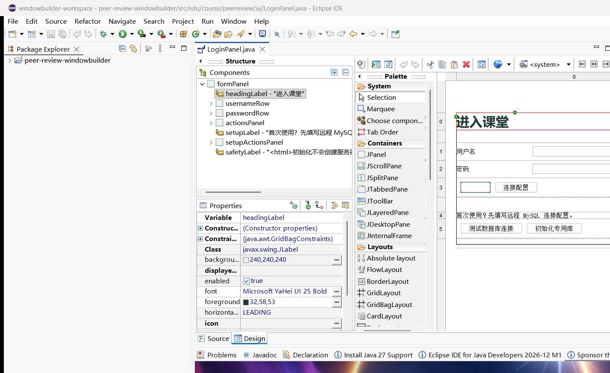
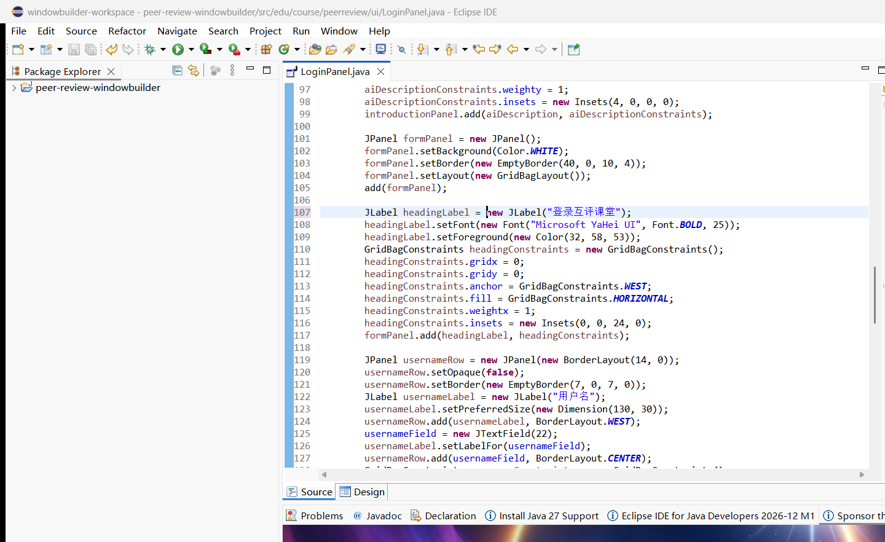
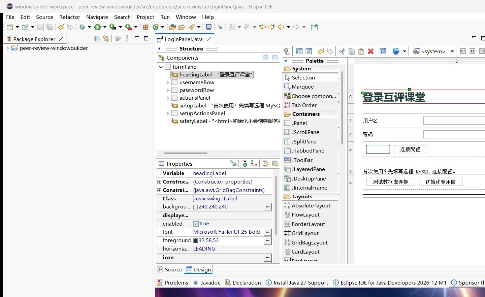
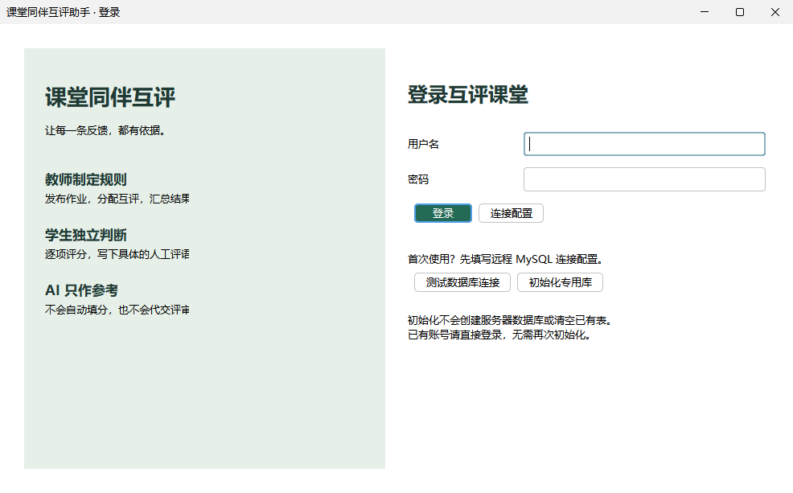
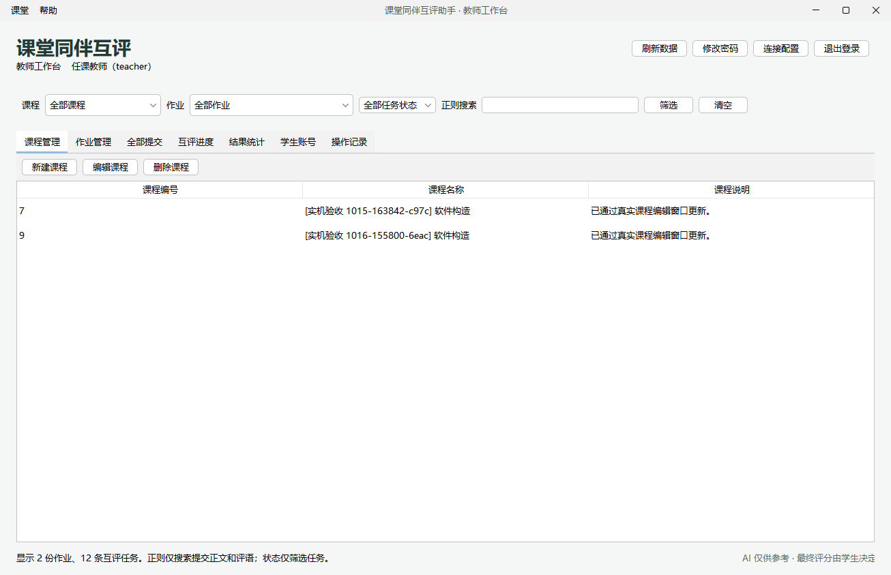

# WindowBuilder 登录表单实际编辑与测试报告

日期：2026-10-16。结果：**PASS**。

## 1. 验证对象与范围

对象是产品中的 `src/main/java/edu/course/peerreview/ui/LoginPanel.java`，由实际 `LoginFrame` 加载，不是另做一个没有接入程序的示例窗口。

使用便携 Eclipse Java 2026-09 / Eclipse 平台 4.41、官方 WindowBuilder Swing Designer 1.25.0、JetBrains Runtime 25.0.4。产品 Maven 编译目标仍为 Java 17。

**已完成登录表单的真实 WindowBuilder 使用，不声称全部业务窗口都由该工具生成。** 当前 Design 画面选择 `formPanel` 作为局部编辑根；完整双栏界面另由产品运行图验证。

## 2. 实际检查结果

| 编号 | 检查内容 | 结果 |
|---|---|---|
| WB-01 | 真实 Eclipse 启动，注册并使用官方 WindowBuilder Editor | PASS |
| WB-02 | 在 Design 视图解析产品源文件，出现 Swing 组件树、Palette 和 Properties，模型为 JPanelInfo | PASS |
| WB-03 | 选择 headingLabel，通过真实 SWT 属性文本控件修改 JLabel.text，不直接替换产品源文件 | PASS |
| WB-04 | WindowBuilder 生成源码改动、标记为未保存，再经编辑器 doSave 保存 | PASS |
| WB-05 | 保存前后 SHA-256 与源码快照一致，实际差异只有标题文字 | PASS |
| WB-06 | 切到 Source 查看生成代码，再切回 Design，标题从“进入课堂”变为“登录互评课堂” | PASS |
| WB-07 | 保存后的完整源码运行 Maven test：75 项、0 失败、0 错误、0 跳过 | PASS |
| WB-08 | App.main 启动实际产品，使用原公网配置完成教师登录、工作台读取；未调用 AI 或新增业务数据 | PASS |

设计器编辑由本地显式验证扩展自动驱动真实编辑器/组件树/属性表及保存事件，属于工具实际使用证据，不冒充学生个人手动拖拽操作。

## 3. 设计器和运行截图

### Design 修改前

[查看原图](01-windowbuilder-design-before.png)



### WindowBuilder 生成的 Java 源码

[查看原图](03-windowbuilder-generated-source.png)



### Design 保存后

[查看原图](04-windowbuilder-design-after.png)



### 实际产品完整登录页

[查看原图](05-product-login-runtime.png)



### 真实远程数据库登录后的工作台

[查看原图](06-teacher-workspace-live.png)



以上 Eclipse 图仅捕获该 Eclipse 的窗口句柄，产品图仅来自本应用组件，不截用户桌面。设计器的系统 Look and Feel 与运行时 FlatLaf 不同，故布局预览与运行画面不完全相同；不能以设计时一张图代替实际运行验证。

## 4. 可核对的源码证据

- [设计器结果与前后 SHA-256](result.json)
- [修改前源码](LoginPanel.before.java.txt)
- [保存后源码](LoginPanel.after.java.txt)
- [真实源码差异](designer-change.diff)
- [本轮成功验证日志](verification-log.txt)
- [75 项测试结果摘要](test-summary.json)
- [产品实际公网登录结果](runtime-smoke.txt)

源码标题变更：

```java
// 修改前
JLabel headingLabel = new JLabel("进入课堂");
// 经真实 WindowBuilder 属性编辑器保存后
JLabel headingLabel = new JLabel("登录互评课堂");
```

## 5. 视图拆分后的回归保护

新增 `LoginPanelTest` 三项：

1. 视图可独立构造、标签与输入框关联正确，设计期不绑定数据库事件。
2. LoginFrame 加载该视图后四个按钮均绑定原事件，默认登录按钮正确，构造时不连接数据库。
3. 实际点击登录按钮，经测试数据库认证后打开可用教师工作台并清空密码框。

此外保留并通过原有 72 项评分、分配、事务、修改/撤回和界面用例。真实公网登录另行验证，不混入默认测试数量。

## 6. 局限与后续工作

- 这里只证明代表性登录表单的实际工具使用；其他业务窗体仍由现有 Swing 代码维护。
- 这是自动化执行的工具操作与测试，个人报告中的学习体会应由使用者结合真实理解完成。
- 仍需整理正式课程设计报告、呈现完整 UML 与数据库字段设计，以及后续安排可运行包验收。
- 本轮不打包 JAR/ZIP，不提交或推送代码，没有新建数据库账号、改防火墙或调用付费 AI。
