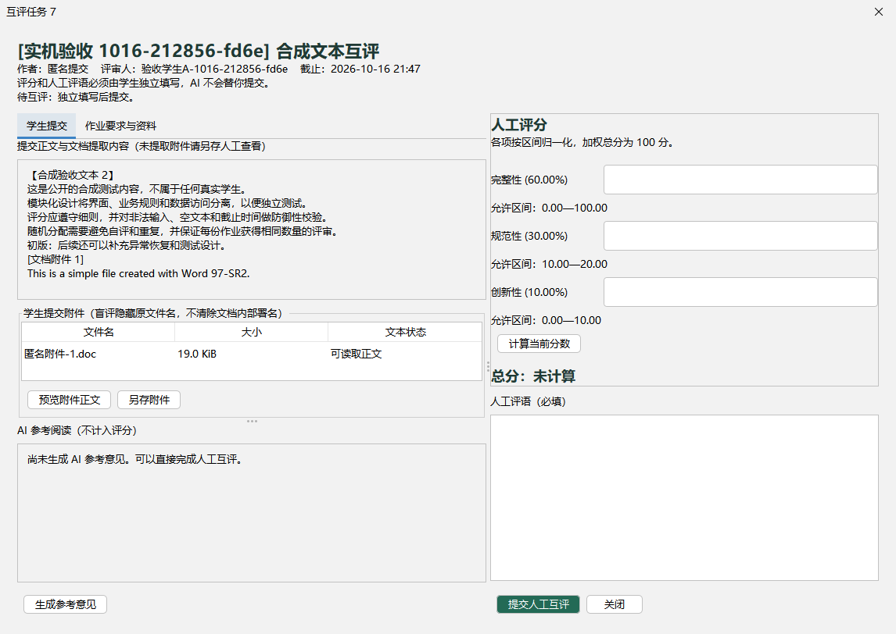

# 课堂同伴互评助手：用户简易使用手册

适用版本：1.1.0 最终实测交付版。更新日期：2026-10-16。

**运行状态：随作业包提供的 1.1.0 程序已通过真实 MySQL、真实 AI 和全部必选与选做功能实测。程序自带 Java 17，但不含数据库密码或 API Key，首次使用须配置自己的服务。**

## 1. 软件与运行条件

这是 Java 桌面软件，不是网页。教师发布课程、作业和评分规则；学生提交、互评，AI 只提供参考。数据保存在 MySQL，文档原件也在数据库中；关闭窗口不会删除已保存内容。

| 使用方式 | 必要条件 |
|---|---|
| Windows x64 便携包 | 完整解压匹配版本的包；联网访问 MySQL；包内 Java 17，无需 IDEA/Maven |
| 独立 JAR | Java 17+、配套 config、可访问的 MySQL |
| 从源码构建 | JDK 17+、Maven、下载依赖的网络；运行还需数据库 |
| AI 辅助 | 可用模型接口、正确协议/模型/Key、网络；不是人工评分的必需前提 |

随包未附课程默认服务凭据。请准备可用的 MySQL 专用库和应用账号；AI 可暂时关闭。演示时建议只使用合成学生和合成作业，不上传真实个人信息或敏感材料。

## 2. 启动与首次配置

### 2.1 启动程序

将整个作业包解压，进入 03_运行程序/peer-review-assistant 后双击 run.cmd，不要只把 JAR 拖出，也不要删除 runtime/config。已有 Java 的环境可在对应 JAR 目录启动：

```bash
java -jar peer-review-assistant.jar
```

程序显示登录页时不必已经连上数据库，也不会自动发送 AI 请求。开发者在 IDEA 中打开 Maven 项目，主类为 edu.course.peerreview.App，工作目录设为项目根。

### 2.2 配置 MySQL

1. 登录页点击“连接配置”，进入 MySQL 页。
2. 填写自己专用库的 JDBC 地址、数据库用户名、密码，按服务要求填写 TLS CA。数据库账号不是应用教师账号。
3. 点击“测试连接与结构”，只检查草稿，不启用新设置。
4. 点击“保存并切换”。缺专用库或表时，程序在账号具备必要权限的情况下准备结构；未知结构冲突会拒绝，不会清空重建。
5. 切换成功后重新登录。新空库回到登录页，显式点击“初始化专用库”，设置首个教师用户名和密码。
6. 只有需要演示数据时才勾选加入合成演示数据。已有用户的数据库不能通过再次初始化覆盖。

正常运行账号只需专用库必要读写权限；自动建库/表可能需要 CREATE/REFERENCES，已知字段升级需要 ALTER。权限不足请联系管理员，不要改用可公开分发的 root。已有库升级应使用增量 SQL 或配置结构准备，不要删库重新初始化。

### 2.3 配置 AI 或关闭 AI

AI 页选择 anthropic 或 openai-compatible，填写匹配地址、模型与 Key。“测试 AI 连通性”只查询模型列表，不发送作业，不生成意见，也不保证该模型推理一定成功。关闭“启用 AI”后仍可正常人工评分。

外部接口要求 HTTPS，只有精确回环 localhost、127.0.0.1、::1 可用 HTTP。勾选“优先使用环境变量”才会用 PEER_REVIEW_AI_KEY 覆盖方案 Key。不要把维护者电脑上的回环网关当成其他电脑可访问的公网服务。

## 3. 教师操作流程

### 3.1 建立账号、课程和作业

1. 教师登录后，在“学生账号”添加学生。用户名不可重复；只允许删除没有业务历史的学生。
2. “课程管理”点击“新建课程”，填写课程名称和说明。
3. “作业管理”点击“发布作业”，填写标题、要求、互评开始与截止时间，选择是否盲评。
4. 添加评分维度，分别设置权重、下限和上限；权重之和必须恰为 100%，上限必须大于下限。
5. 如有教学资料，在附件区点击“添加附件”，可预览、替换、移除，最后点击作业保存按钮才会入库。

互评开始时间也就是学生提交截止时间。开始必须晚于创建时刻，截止晚于开始。已有学生提交后，作业、规则和教师资料被冻结，请新建作业而不是更改已使用的评分口径。

### 3.2 查看提交和分配

“全部提交”可阅读学生文本和资料，授权预览/另存附件。开始互评后，在“作业管理”选择作业，点击“随机分配互评”，填写每份需 N 人评审。

若已提交人数为 M，必须 M≥2 且 1≤N<M。只有已提交者参与，未提交的旁观学生不会分到任务。每份 N 个不同评审人，每人 N 条任务，无自评；成功后不能重复分配。时间到达不会自动分配，需要教师主动触发。

### 3.3 查看结果和导出

“互评进度”查看任务及已完成评审；“结果统计”显示各提交已评/分配人数、平均分、最高分和最低分。先在上方选定一份作业，再点击“导出当前统计 CSV”。CSV 是汇总表，不含每条评分的全部维度明细。

未完成或撤回的评分不计入平均，尚无人评审时为空，不是 0 分。截止前结束互评要求全部任务完成；截止后允许带着未完成任务结束。结束后不再允许评分修改或撤回，教师也不能代改学生分数。


## 4. 学生提交作业

1. 学生登录，在“课堂作业”选择作业，点击“查看要求”，阅读说明、评分规则与教师资料。
2. 点击“提交 / 更新作业”，输入正文或添加文档。可以只交文档，但正文与附件不能同时为空。
3. 添加后可选中附件，点击“替换附件”“移除附件”或“预览正文”。这些是未保存草稿，最后必须确认保存提交。
4. 在“我的提交”检查结果。互评开始前可再次更新，时间到达后停止提交，即使教师还没有分配任务。

支持 PDF、DOC、DOCX、TXT、MD，每次最多 3 个、每个不超过 5 MiB。文件内容相同不能重复添加。文件存入数据库后，上传源文件移走不影响授权下载。

### 4.1 附件文本状态说明

| 状态 | 意义与做法 |
|---|---|
| 可读取正文（EXTRACTED） | 可预览提取文字、参与搜索及 AI 阅读；不保证保留图表和排版 |
| 无可提取正文（NO_TEXT） | 扫描或图片 PDF 等，可另存人工阅读；没有 OCR |
| 加密文档（ENCRYPTED） | 保留原件可下载，不能假装已读；请自行解密导出或补摘要 |
| 正文过长（TEXT_TOO_LONG） | 超出提取限制；不静默截断，请精简或补摘要 |

单附件提取上限为 20000 字符，PDF 还限制页数，AI 合并输入正文、资料与要求有 60000 字符限制。资料是否能供 AI 阅读应看状态，不是看扩展名。

## 5. 学生完成人工互评

在“我的互评任务”选中待评任务，点击“查看 / 填写互评”。左侧阅读正文和文档，右侧逐项独立填写分数与人工评语。

盲评显示匿名提交和“匿名附件-序号.扩展名”，但不会清除文档内部署名、属性或正文的身份线索。预览为提取文字，不是完整 Word/PDF 页面；图表或扫描内容请另存人工查看。

可以点击“生成参考意见”，先阅读外发及费用确认。成功后 AI 文本只出现在参考区，不代填分数、不代写人工评语、不代提交。若请求失败，可以继续人工评分，不需要重复点击生成；每次显式请求可能单独计费。

各维度按自身区间归一化再加权。例如权重 60%、0—100 得 80，另项权重 40%、10—20 得 15，总分为 68.00。填写所有评分项及人工评语，点击“计算当前分数”核对，再“提交人工互评”并确认。



## 6. 修改、撤回和查看成绩

已完成任务默认只读。本人在互评时间内且作业未结束时，可点击“修改评分”→编辑→“保存修改”；保存后重新计算统计，任务仍为完成，不增加评审人数。

“撤回互评”确认后删除该次人工分数、明细和人工评语，任务恢复待评，成绩统计不再计入；分配关系和 AI 意见保留。要再次评分必须独立重新填写。此操作不提供旧评语全文恢复。

若提示版本冲突，关闭旧窗口、刷新后重新打开，不能用旧窗口覆盖新结果。教师不能代改，截止或结束后不能再改/撤回。学生在“我的成绩”只能看自己的汇总。

## 7. 搜索与筛选

上方依次选择课程、作业及任务状态，在“正则搜索”输入表达式后点“筛选”；点“清空”恢复。正文、人工评语及成功提取的附件正文可按对应列表检索，任务状态只筛任务。

示例：“模块|测试”匹配任一词，“^建议”匹配文本开头。使用 RE2/J 语法，不支持回溯引用或前后向断言；表达式错误时修正或清空，不需要重启软件。

## 8. 常见问题与恢复

| 提示或现象 | 处理 |
|---|---|
| 数据库连接失败 | 核对主机、网络、库名、账号权限及 CA；公网出口变化可能影响来源授权；不要关闭 TLS 校验图省事 |
| 缺表或结构冲突 | 新专用库授权后准备；旧库按迁移 SQL 升级；冲突请管理员处理，不删除已有数据 |
| 登录失败 | 确认使用应用账号，不是数据库账号；切库后账号也属于新库 |
| 不允许提交或分配 | 核对设备时间、作业阶段和互评窗口；开始时刻后学生停止提交 |
| 不能编辑或删除作业 | 已有提交后规则被冻结；新建作业，勿绕过历史保护 |
| 不能添加附件 | 检查格式、5 MiB/3 个限制、重复内容及文件名；损坏文件请重新导出 |
| 不能撤回／旧版本冲突 | 检查是否本人、是否截止/结束；刷新并重新打开最新记录 |
| AI 失败或无可读正文 | 可继续人工评审；补充摘要、核对模型/Key；不要盲目反复产生付费请求 |
| 无人评分却没有 0 分 | 正常，空值表示暂无有效评分，检查已评/分配人数 |
| CSV 中文或公式显示异常 | 用支持 UTF-8 的表格软件导入；安全前缀防止内容被当成公式，不要随意移除 |
| 首次未配置或自备服务停止 | 在连接配置填写或切换可用的 MySQL/AI；原库数据不会自动迁移 |
| 保存方案或文件失败 | 检查目录写权限及占用；失败不等于已切换成功，先保持原配置再重试 |

## 9. 配置与数据安全

config/application.properties 和方案文件保存的是本地明文密码/Key，请限制文件权限，不要将填写了个人凭据的目录发给其他人。掩码输入框不是文件加密。本提交包不含维护者的演示账号密码；初始化时可自行选择加入合成演示数据，演示学生公开初始密码不适合真实课堂。

退出登录只清除当前业务会话，不删除数据库。备份业务数据请使用数据库备份流程，不能只复制客户端目录。导出成绩和下载文档可能包含敏感内容，应妥善保存。

## 10. 验收演示建议顺序

准备一个教师、3 名合成学生；教师发布带文档的作业与合法评分项→学生文本或仅文档提交→到时间后 N=2 分配得到 6 条任务→学生核对匿名下载并人工评分→教师核对统计和导出→本人演示修改/撤回→重新登录验证持久化。

AI 生成是可选且需要外发确认的单独步骤，不应在未授权演示中自动调用。完整步骤及安全边界以《课程设计报告》《交付说明与当前进度》为准。

## 11. 随包材料与已验证结果

报告、手册与交付说明位于 01-报告与手册；完整 Maven 源码位于 02_源代码；建表与旧版升级脚本位于 04_数据库与配置。不要直接对已有业务库执行初始化或删除表，先按实际版本选择增量迁移。

最终包已在真实 MySQL 上验证教师发布、学生文本/文档提交、N=2 盲评、N=1 非匿名、人工评分、统计、CSV、日志、配置及一次真实 AI 生成；PDF/DOC/DOCX/TXT/MD 均有对应操作证据。关闭匿名后，实际作者和原文件名显示；开启匿名后，作者和文件名匿名化。文档内部署名仍不会自动清理。

评分修改/撤回实测为 82→88→撤回→75。撤回时有效人数归零、均值和极值为空；重新提交后只计算新记录。配置保存后另起 Java 进程再读评分、独立 AI 意见及附件，结果一致。

这些结果证明本轮覆盖的流程通过，不意味着已测试所有操作系统或网络故障。复现真实 AI 时每次显式生成可能计费，连通性按钮只查询模型列表。详细证据见 05_测试与验收。
