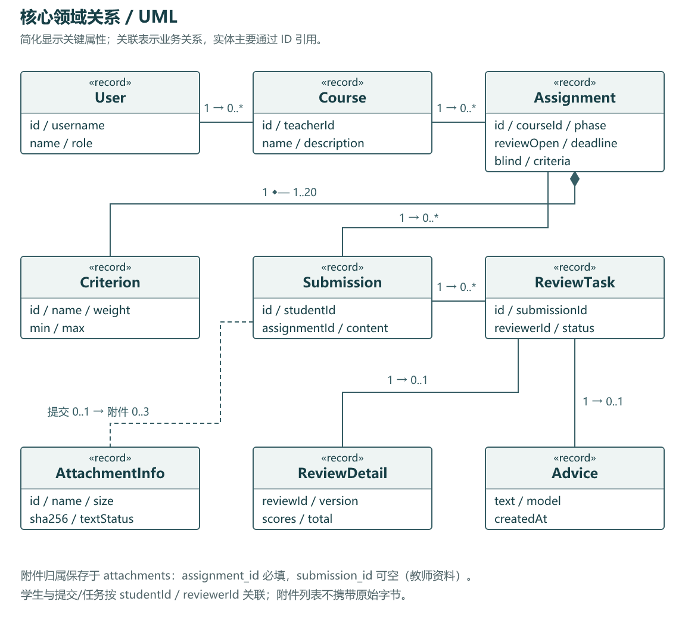
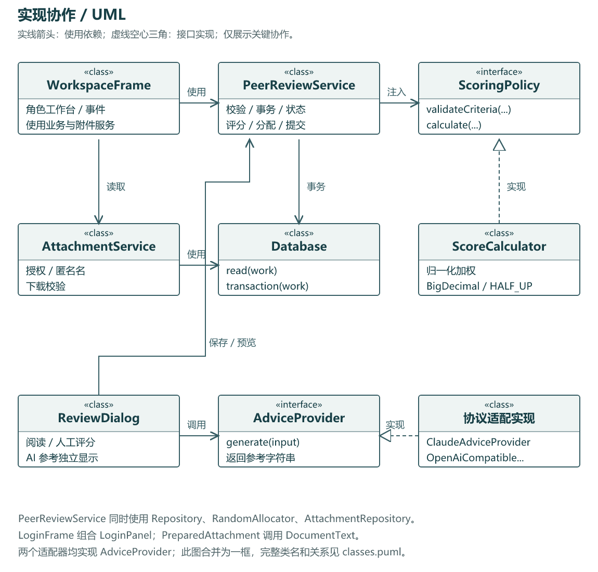
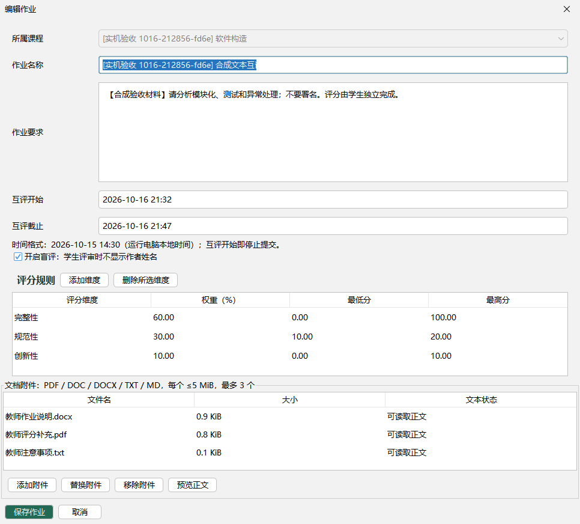
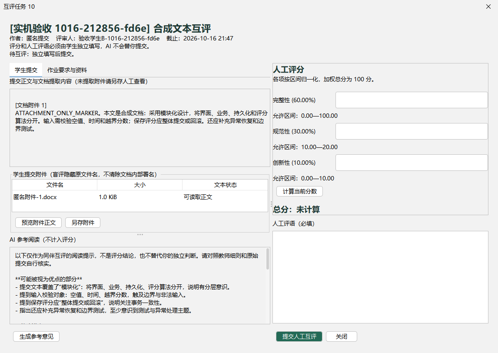
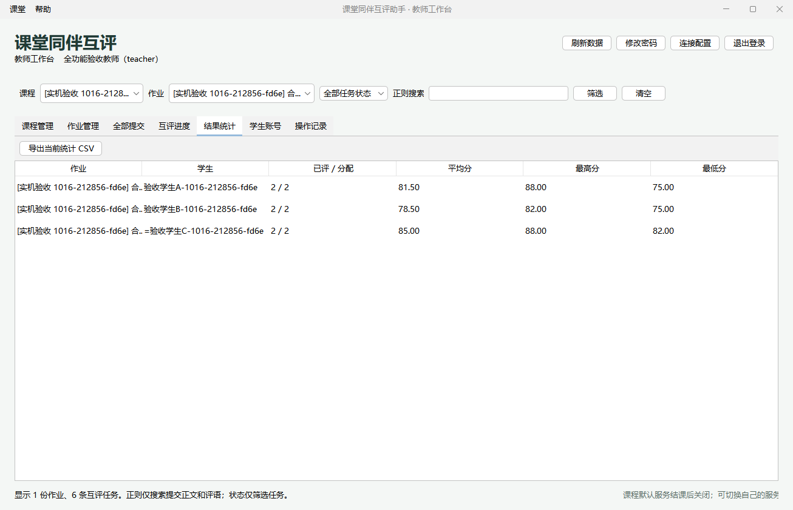

# 基于 Java 的 AI 辅助课堂同伴互评工具设计与实现

软件构造课程个人项目设计与交付报告

| 项目 | 内容 |
|---|---|
| 学生姓名／学号／班级 | 鲁雨博／2024214815／2403 |
| 课程 | 软件构造 |
| 项目名称 | 课堂同伴互评助手 |
| 源码版本 | 1.1.0（含文档附件） |
| 编写及核对日期 | 2026 年 10 月 16 日 |
| 报告状态 | 最终实测交付版 |

## 摘要

本项目针对课堂同伴互评中评分口径不统一、任务分配繁琐、反馈缺乏针对性和成绩统计易出错等问题，设计并实现一个 Java 桌面工具。系统采用 Swing 与代表性 WindowBuilder 表单、MySQL/JDBC、Maven 和 JUnit，组织教师发布作业、学生文本或文档提交、均衡随机分配、盲评、人工逐项评分、AI 参考阅读、成绩统计与 CSV 导出的完整流程。AI 意见与人工评分独立存储，最终决定仍由学生作出。

实现中将加权评分和任务分配提取为可独立测试的组件，以数据库事务、唯一约束、作业行锁及记录版本维护状态一致性；附件原始字节与提取文本存入 MySQL，并在授权下载时校验 SHA-256。当前 1.1.0 源码在 Java 17 下复跑 123 项默认测试，失败、错误与跳过均为 0；另有实际 Swing、远程数据库、文档与真实模型参考生成的独立验收记录。

当前源码、含依赖 JAR 与 Windows x64 Java 17 运行程序均为 1.1.0。最终便携包已独立解压，以实际 java -jar 入口完成真实 MySQL、一次真实 AI 生成及全部必选和四项选做实测；主流程 30 个检查点、修改撤回与补充流程 25 个检查点均通过，两批有重复启动检查，不合并宣称为 55 项独立功能。新 JVM 再读成绩、AI 意见和附件均通过。文档更新没有修改已验收的产品 JAR，也不将自动化操作描述为本人手动操作经历。

关键词：软件构造；同伴互评；Swing；JDBC；策略模式；人工智能辅助；回归测试

## 阅读说明

第 1—8 章给出需求、模块、UML、数据库、算法、重构复用、测试和交付；第 9 章逐一展开课程九章知识的应用、效果和思考；第 10 章为基于项目事实的学习总结与局限。用户操作另见《用户简易使用手册》。所有截图来自合成验收数据，不代表真实学生材料。

## 第 1 章 需求分析

### 1.1 项目背景与问题分析

同伴互评是课堂教学中常见的学习活动。学生不仅需要完成作业，还需要阅读他人的成果，并依据评分细则判断其优点与不足。与只接收教师给出的分数相比，参与评审能够促使学生理解评价标准、发现不同解决思路，并在提出反馈的过程中检验自身认识。

但是，同伴互评并不等同于让学生自由打分。如果缺少明确规则和过程管理，实际开展时容易出现以下问题。

（1）**评分依据不统一。** 不同学生对“完整”“规范”“有创新”等描述的理解可能存在差异。如果评分维度、权重和允许分值没有清晰定义，最终成绩就难以解释，也不便于比较。

（2）**反馈内容缺少针对性。** 学生可能只填写“完成得不错”“需要改进”等笼统评语，未能指出具体问题。部分学生还会因为缺乏评价经验，不知道应从哪些方面阅读和分析作业。

（3）**任务分配与过程记录繁琐。** 教师需要安排评审关系、避免学生评审自己的作业、追踪未完成任务，并记录每一次评审结果。依靠人工表格维护时，容易发生漏分配、重复记录或状态不一致。

（4）**成绩汇总与结果核对成本较高。** 一份作业往往由多名学生评审，需要根据评分细则计算每次评审总分，再汇总平均分、最高分和最低分。手工计算既重复，也容易在修改、撤回评分后保留过时结果。

（5）**身份信息可能影响评价。** 当评审人知道提交者姓名时，熟悉程度和人际关系可能影响判断。因此，系统需要提供盲评能力，在评审界面隐藏提交者的身份字段。

文本大模型能够辅助阅读作业，给出值得关注的优点、问题和核实方向，但其输出也可能存在遗漏、误解和不准确内容。因此，本项目没有将 AI 设计为自动判分者，而是将其定位为参考意见提供者：评分规则由教师确定，最终分数和人工评语由学生独立填写，系统负责记录、计算和汇总。

基于上述问题，本项目开发一款 Java 桌面版 AI 辅助课堂同伴互评工具，将课程作业管理、文本提交、随机任务分配、盲评、人工评分、AI 参考意见及结果导出组织为一个完整业务流程。

### 1.2 建设目标与系统范围

本项目的总体目标，是在小型课堂场景下提供一套规则明确、过程可追踪、结果可核对的同伴互评工具，同时通过完整开发过程落实软件构造中的模块化、面向对象设计、数据库编程、测试、重构和软件复用等知识。

具体目标包括以下方面。

1. **建立清晰的评价依据。** 支持教师动态设置评分维度、权重和分值区间，使学生能够依据同一组规则完成评审。
2. **形成完整的业务闭环。** 将发布作业、学生提交、随机分配、人工互评、结果统计和 CSV 导出衔接起来，避免系统停留在简单数据增删改查层面。
3. **保留人工判断的主体地位。** AI 仅提供参考文本，不自动填入评分框，不直接形成最终互评结果。
4. **提高数据与状态的一致性。** 对任务分配、评分保存、修改和撤回设置事务边界，防止部分操作成功而其他关联数据未更新。
5. **降低运行与配置门槛。** 提供可独立运行的 Windows 发行包，并支持在界面中检查、保存和切换数据库及 API 方案，使软件不依赖某一套长期不变的个人环境。
6. **为质量验证提供依据。** 将核心算法与界面、数据库分离，支持确定性的单元测试、集成测试和实际运行验收。

系统采用 Java 桌面客户端形态，使用 Swing 完成人机交互，通过 JDBC 访问 MySQL，并通过外部文本模型接口获取参考意见。业务数据存储在 MySQL 中，数据库连接参数、API 参数和连接方案保存在本地文件中。

本项目面向课堂级的小型应用，不建设独立的在线业务服务器，不实现跨学校教学平台、课程选退课、复杂组织架构或多人实时协同编辑。应用中的学生使用统一账号集合浏览课程并提交作业，当前没有另外建立课程成员或班级管理体系。1.1.0 已实现教师发布资料及学生文档提交的选做扩展，支持 PDF、DOC、DOCX、TXT、MD，允许仅文档提交；每次最多 3 个文件、单文件不超过 5 MiB。附件正文提取不等于完整页面渲染，不提供 OCR、宏执行或全文身份脱敏。

### 1.3 用户角色与使用场景

系统包含教师和学生两类业务角色。除业务角色外，还需要考虑在本机准备运行环境、配置数据库和模型接口的使用者。连接设置属于客户端运行配置，不应与某一数据库内已经登录的教师、学生身份混为一谈。

**表 1-1 用户角色与主要操作**

| 角色或使用者 | 主要操作 | 访问边界 |
|---|---|---|
| 教师 | 管理自己创建的课程和作业，设置评分细则与互评时间，查看提交，触发分配，查看评审和统计，导出 CSV，管理应用中的学生账号 | 不能管理其他教师的课程，不能代替学生修改或撤回人工评分 |
| 学生 | 查看课程作业要求，提交或更新自己的文本，完成分配给自己的任务，查看自身成绩，在允许阶段修改或撤回自己的评审 | 不能访问未分配给自己的评审任务，不能查看其他学生的个人成绩 |
| 本机配置使用者 | 设置和测试 MySQL、AI 接口，保存多个连接方案，初始化新数据库的首个教师账号 | 切换数据库后必须重新登录，不能沿用原数据库中的用户身份 |

教师使用场景从创建课程和发布作业开始。教师录入作业要求、评分项、权重、分值区间，以及互评开始和截止时间。学生在提交截止前完成文本提交。到达互评时间后，由教师显式触发随机分配，而不是由系统在后台自动生成任务。

学生评审时，应先阅读作业内容与评分规则，可以按需获取 AI 参考意见，再独立填写各项分数和人工评语。教师通过任务列表检查进度，通过统计面板核对结果并导出成绩。

在软件初次运行或课程演示服务关闭后，本机使用者可以进入连接配置界面，改用自己的数据库和 AI 服务。数据库切换成功后，系统返回登录界面，以新数据库中的账号重新建立业务身份。

### 1.4 功能需求分析

为便于后续设计、测试和验收追踪，将主要功能划分为表 1-2 所示的需求项。

**表 1-2 系统功能需求**

| 编号 | 功能需求 | 主要内容与约束 |
|---|---|---|
| FR-01 | 用户认证与账号管理 | 区分教师、学生；支持登录和本人修改密码；由教师创建学生、修改学生姓名及删除尚无业务历史的学生账号；用户名须唯一 |
| FR-02 | 课程管理 | 新增、编辑、查询和删除课程，记录课程名称、说明及所属教师；仍有作业的课程不得直接删除 |
| FR-03 | 作业与评分细则管理 | 设置标题、说明、互评起止时间和盲评开关；动态维护评分项、权重及区间；已有提交后冻结作业与规则，避免评价口径改变 |
| FR-04 | 文本与文档提交 | 保存提交学生、内容和时间；每名学生对同一作业保留一份当前提交，截止前允许更新；正文或附件至少一项非空；校验长度、文件格式、大小和数量 |
| FR-05 | 随机分配与盲评 | 在已提交学生之间分配，每份提交交由 N 名不同学生评审；排除自评，区分待评与完成状态；盲评时隐藏作者姓名字段 |
| FR-06 | 人工评分与评语 | 学生按全部评分项填写分数及人工评语，系统校验区间并计算加权总分；保存评审人、任务、评分明细和评审时间 |
| FR-07 | 评分修改与撤回 | 仅本人在互评时间内且作业未结束时操作；修改后重算总分；撤回后删除该次人工评分与明细、恢复待评，保留任务分配和 AI 意见 |
| FR-08 | AI 辅助阅读 | 向配置的模型接口发送作业要求、评分细则和提交正文，展示参考意见；参考文本与人工评审分开保存，不自动代填或代交 |
| FR-09 | 检索与组合筛选 | 用正则表达式搜索提交正文和人工评语；按课程、作业限制当前记录范围，按任务状态筛选互评任务 |
| FR-10 | 统计与 CSV 导出 | 对每份提交计算有效评审的平均分、最高分和最低分，显示已评人数及分配人数；由教师导出当前作业的汇总成绩 |
| FR-11 | 持久化与操作记录 | 业务数据保存到 MySQL；记录初始化、提交、分配、评分、修改、撤回等操作摘要，便于教师检查近期过程 |
| FR-12 | 运行配置与独立交付 | 提供课程默认服务提示，分别测试和切换 MySQL、AI；检查并安全准备数据库结构；提供不依赖 IDE 的运行方式；最终 1.1.0 已独立解压实测，分发包不带凭据 |
| FR-13 | 文档附件 | 教师资料与学生提交均支持添加、替换、移除、提取正文预览、授权下载；文件存数据库；盲评隐藏原文件名；成功提取的正文参与搜索及 AI 输入 |

其中，FR-03 的动态评分不是只允许使用固定的“完整性、规范性、创新性”三项。教师可以根据作业内容增加或减少维度，但必须保证名称、权重与分值区间合法。系统要求权重之和为 100%，以便统一解释最终总分。

FR-07 不是重新插入一份重复评分。修改操作更新当前评分及明细，任务仍保持完成；撤回操作则使任务回到待评，并将该次分数移出统计。撤回后若需再次评分，学生必须重新填写，日志只保留动作及版本、总分等摘要，不提供原评语全文的历史恢复功能。

FR-13 的附件与所属作业或提交在同一事务中保存，而不是只登记上传电脑的绝对路径。教师资料通过空的 submission_id 与作业关联；学生文档关联具体提交。盲评评审人只能收到“匿名附件-序号.扩展名”，原始文件字节不被改写，因此文件正文、属性或内部署名仍可能包含身份线索。

FR-08 中，AI 输出即使包含看似合理的判断，也不能直接等同于人工结果。系统不把模型输出解析为可自动保存的评分。模型接口失败时，应提示学生并允许继续人工评审，避免将外部服务可用性变成人工评分的强制前提。

FR-12 要求将“编辑配置草稿”和“启用配置”区分开。MySQL 测试应检查连接及必要结构，切换时创建缺失的专用库、表或补齐已知安全字段；对可能影响已有数据的不兼容结构，应拒绝切换而非清空重建。AI 连通性测试只发送带认证的模型列表查询，不发送作业、不生成参考意见，也不将连接成功误认为已验证模型推理质量。

### 1.5 业务流程与状态约束

#### 1.5.1 作业生命周期

作业分为收集提交、互评中和已结束三个阶段，分别对应 `SUBMISSION`、`REVIEWING` 和 `CLOSED`。

**表 1-3 作业阶段及可执行操作**

| 阶段 | 允许的主要操作 | 转换条件 |
|---|---|---|
| 收集提交 | 学生在互评开始前提交或更新文本；教师在无提交时修改作业及规则 | 教师在互评时间窗口内成功分配任务后进入互评中 |
| 互评中 | 学生完成任务、修改或撤回自己的评分；教师查看进度和统计 | 教师执行结束操作；截止前须全部任务完成，截止后允许保留未完成任务结束 |
| 已结束 | 按原权限查看提交、评审和统计，教师导出成绩 | 本次设计不提供重新开启已结束作业的功能 |

阶段与时间共同决定操作是否允许。互评开始时间同时作为提交截止时间，即使教师尚未分配、作业阶段仍为收集提交，到达该时刻后也不能继续更新提交。系统不会仅因时钟到达就自动分配任务或结束作业，相关转换仍由教师显式触发。

核心时间判断使用运行客户端的本地时钟，因此使用时应保持设备时钟和时区一致。如果进一步扩展为多终端在线教学平台，需要考虑统一的服务端时间来源，而不能继续依赖各客户端自行判断。

#### 1.5.2 随机分配约束

设已提交学生人数为 M，每份提交需要 N 名评审人，则必须满足：

```text
M ≥ 2，且 1 ≤ N < M。
```

同一学生在同一作业中只有一份当前提交，因此可以根据提交人建立参与集合。分配必须同时满足不自评、同一提交的评审人不重复、每份获得 N 次评审机会等要求。本项目进一步使每名参与学生也恰好获得 N 条任务，以避免评审负担明显不均。

人数不足、N 非法或名单重复时，应拒绝分配，而不是悄悄减少任务数或不断随机重试。分配与作业阶段更新必须整体提交，失败时不能保留部分任务。

#### 1.5.3 互评任务与评分记录

任务状态包括 `PENDING` 和 `COMPLETED`。待评任务成功提交人工评审后变为完成，完成任务不能再次走新增路径插入重复结果。

对于仍在有效时间内的已完成任务，学生本人可以显式修改或撤回。修改必须重新校验全部评分项和人工评语；撤回必须同时删除评分主记录及明细，并恢复任务状态。任何一步失败，都应保留原来的完整状态。

为避免两个窗口相互覆盖，修改和撤回需要检查评分记录标识及版本号。仅比较版本号还不够，因为撤回重新提交后，新记录也可能从版本 1 开始；因此必须同时核对记录 ID，以拒绝旧窗口对新记录的操作。

#### 1.5.4 加权计算与统计规则

设某评分维度的得分为 s，允许区间为 [a, b]，百分比权重为 w，则该维度先在区间内归一化，再计算加权贡献。一次人工评审的总分为：

```text
总加权得分 = Σ [(sᵢ − aᵢ) / (bᵢ − aᵢ)] × wᵢ
其中 Σwᵢ = 100，wᵢ > 0，且 0 ≤ aᵢ ≤ sᵢ ≤ bᵢ、bᵢ > aᵢ。
```

该公式使不同分值上限的维度能够统一汇总为百分制总分。例如，完整性权重 60%、区间 0—100、得分 80；规范性权重 40%、区间 10—20、得分 15，则总分为 0.8×60＋0.5×40＝68.00。需要明确的是，本设计采用相对区间归一化，区间下端对应该项加权贡献为 0。

每份提交的综合互评成绩采用当前有效人工评审总分的算术平均，同时计算最高分和最低分。未完成或已撤回的评审不计入分母，也不按零分处理。没有有效评分时，统计值为空，并通过“已评人数／分配人数”反映进度，避免将“尚未评分”误解为“得了零分”。

#### 1.5.5 历史保护与配置边界

已有学生提交后，作业和评分细则被冻结，防止修改分值区间、权重或题目要求后破坏历史评分依据。仍有作业的课程、已有业务历史的学生账号不能直接删除。这些限制属于保证记录完整性的业务约束，不代表任意阶段都允许物理删除。

数据库切换只改变本客户端后续连接目标，不自动搬迁原库数据。切换成功后必须退出原登录，防止把原数据库的用户 ID 和角色直接带到另一个数据库。课程演示服务的关闭由维护者处理，客户端不对使用者自备服务设置日期锁。

### 1.6 非功能需求

**表 1-4 非功能需求**

| 类别 | 具体要求 |
|---|---|
| 正确性 | 校验空值、日期、权重、分值区间和任务状态；保证评分计算、任务分配及统计规则一致 |
| 一致性与可靠性 | 为分配、评分、修改和撤回建立事务；数据库约束与版本检查共同防止重复或过时写入；失败后提供明确提示 |
| 易用性 | 教师与学生使用不同工作台；用任务状态和统计人数反馈进度；关键删除、评分保存和撤回操作需确认 |
| 响应性 | 将数据库与网络请求放在后台任务中执行，避免长时间占用 Swing 事件线程；操作期间控制重复点击 |
| 安全与隐私 | 使用参数化 SQL、带盐密码哈希和角色校验；界面掩码显示数据库口令与 API Key；AI 外发前提示内容与风险；合成演示数据不得用于保存真实个人材料 |
| 可维护性 | 将领域数据、核心算法、数据库访问、API 适配和 GUI 职责分开，尽量降低规则变化对其他部分的影响 |
| 可测试性 | 核心算法能够脱离 GUI 测试；关键业务时间、随机性与评分策略可以受控，便于复现边界场景 |
| 可交付性 | 提供 Maven 源码、可运行 JAR 及 Windows x64 Java 17 便携包；配置不绑定开发目录，可自行配置或更换服务 |

安全需求需要结合架构边界解释。用户登录密码采用带盐哈希存储，但数据库密码和 API Key 仍保存在本地明文配置中，掩码输入不等于文件加密。桌面程序直连数据库也意味着持有连接凭据的客户端并不是强安全隔离边界，因此该架构适用于本课程的小型教学项目，不应直接宣称具备面向不可信客户端的生产级权限隔离。

盲评同样具有边界：系统隐藏作者身份字段，但不会自动识别和删除正文中的署名。发送 AI 请求时，不附加账号或作者姓名字段，也不能据此保证正文没有个人信息。实际使用前仍应清理正文并取得必要授权。

### 1.7 本章小结

本系统的需求重点不是增加尽可能多的数据管理页面，而是把评价规则、任务分配、人工决策和成绩汇总组织为受约束的流程。通过明确参与角色、状态、时间、评分公式和异常处理要求，可以为后续设计提供可检查的依据。其中，AI 辅助与人工结果分离、任务与评分记录一致、配置切换后重新认证，是本项目相较于普通增删改查程序更需要关注的需求。

## 第 2 章 系统模块化分解

### 2.1 模块划分思路

系统采用单个 Maven Java 项目，通过包、接口和类划分逻辑模块，不将其拆成多个独立服务。对于本项目的规模，微服务、独立 Web 前端或大型依赖注入框架会增加部署和理解成本，并不能直接解决评分、分配和状态一致性问题。

模块划分遵循以下原则。

（1）**按变化原因区分职责。** 窗口布局、评分公式、随机分配和数据库连接具有不同的变化来源。界面调整不应要求修改评分算法，更换 API 协议也不应改变人工互评记录的存储规则。

（2）**将可独立验证的规则提取出来。** 加权计算和随机分配适合设计成不依赖 Swing、JDBC 的独立组件，从而用较小的输入集合验证正常结果和边界行为。

（3）**在完整业务用例处组织事务。** 任务分配不仅是插入任务，还涉及作业阶段和操作日志；撤回也不仅是删除一行评分。事务应围绕完整用例建立，而不是由每个按钮或每条 SQL 各自决定提交。

（4）**优先复用稳定公共能力。** 参数绑定、密码处理、配置读写、CSV 转义和后台任务属于多处需要的能力，应集中封装，避免在各窗口中重复实现。

（5）**保持职责分层与实际依赖一致。** 本项目采用职责分层，但不是所有包都形成严格的单向依赖图。配置和 AI 适配会共享校验与异常类型，业务服务也直接调用 JDBC 工具完成部分事务写入。对这些实际关系应如实说明，而不是仅凭包名就将系统描述成完全独立的标准 MVC 或多层框架。

### 2.2 总体结构

系统的主要依赖方向是：GUI 接收操作，业务服务校验身份、时间和状态，再调用算法或数据库组件完成处理。AI 属于辅助路径，返回结果单独保存，不进入人工评分的自动计算来源。

```text
教师／学生操作
      │
      ▼
Swing 界面与事件处理（ui）
      │
      ├── 业务服务（service）
      │       ├── 领域数据与状态（domain）
      │       ├── 评分策略（scoring）
      │       ├── 随机分配（allocation）
      │       └── JDBC 连接、映射与参数绑定（dao）── MySQL
      │
      ├── AI 参考接口（ai）── 外部模型服务
      │       └── 参考意见由业务服务单独持久化
      │
      └── 配置与工具（config、util）
              ├── 本地设置及连接方案
              └── 正则筛选、CSV、密码与公共校验能力
```

上述结构表达的是主要调用职责，不代表每条依赖都只能沿图中的单一路径。例如，界面会直接使用筛选和 CSV 工具，配置界面会调用表结构检查服务及 AI 连通性检查。关键是这些操作没有把评分规则和任意 SQL 拼接散落到按钮中。

当前项目的主要代码组织如下。

```text
edu.course.peerreview
├── App.java                    程序入口与运行环境组装
├── domain                      领域记录、状态及结果对象
├── service                     用户、互评、初始化、结构检查与业务校验
├── scoring                     评分策略接口及归一化加权实现
├── allocation                  随机任务分配
├── dao                         JDBC 连接、查询映射与参数绑定
├── ai                          提示构造、协议适配及连通性检查
├── attachment                  文件校验、受限正文提取与安全另存
├── ui                          Swing 视图、窗口、事件和后台任务
├── config                      当前配置及多方案管理
└── util                        密码、CSV、正则与表驱动筛选
```

业务建表规范位于 `src/main/resources/schema.sql`，测试代码位于 `src/test/java`。配置文件位于运行目录的 `config` 下，不把真实密码或 Key 写进产品 Java 源码。

### 2.3 模块职责与边界

**表 2-1 逻辑模块及主要实现**

| 模块 | 主要类或接口 | 主要职责 |
|---|---|---|
| 领域数据 | `Domain` 中的各类 record 与枚举 | 表达用户、课程、作业、评分项、提交、任务、评分明细、统计和参考意见 |
| 业务服务 | `PeerReviewService`、`AuthService`、`InitializationService`、`SchemaManager` | 组织用例、权限与状态校验、事务、初始化和结构准备 |
| 评分规则 | `ScoringPolicy`、`ScoreCalculator` | 校验评分细则和分项，统一计算归一化加权总分 |
| 任务分配 | `RandomAllocator` | 校验名单和人数，通过洗牌与循环错位生成均衡评审关系 |
| 数据访问 | `Database`、`Jdbc`、`Repository` | 管理连接与事务作用域，绑定参数，映射查询结果，执行统计聚合及日志写入 |
| AI 适配 | `AdviceProvider`、`AdvicePrompt`、`AiServices` 及两个协议适配类 | 生成参考意见、隔离协议差异，单独执行只读连通测试 |
| GUI | `LoginPanel`、`LoginFrame`、`WorkspaceFrame`、`AssignmentDialog`、`ReviewDialog`、`ConfigDialog`、`Ui` | 布局、角色工作台、事件分发、状态展示及后台任务交互 |
| 配置 | `AppConfig`、`ConfigProfiles` | 默认与个人配置读取、草稿快照、原子启用和数据库/API 方案保存 |
| 公共工具 | `Passwords`、`CsvExporter`、`TableFilter`，以及共享 `Validation` | 提供可复用的安全编码、文件输出、过滤和输入校验能力 |
| 附件 | `PreparedAttachment`、`DocumentText`、`AttachmentFiles`、`AttachmentRepository`、`AttachmentService` | 受限文件解析、字节持久化、变更事务、授权下载和匿名文件名 |

#### 2.3.1 领域数据模块

领域数据集中定义在 `Domain.java` 中。系统使用不可变记录表达主要数据，并通过枚举表示角色、作业阶段和任务状态，避免在多处使用含义不清的数字或任意字符串。

`Assignment` 包含评分细则集合，`ReviewDetail` 包含各项得分映射。构造时对集合进行防御性复制，减少外部代码修改集合后影响已有对象的风险。实体间主要通过 ID 建立关系，不依赖每个对象都持有其他实体的完整可变实例。

该模块不包含 SQL 或 Swing 控件。可展示的 `User` 也不携带密码哈希，减少认证数据在界面和业务结果对象间不必要的传播。领域模块并非完整的领域驱动模型，其中多数对象承担的是明确的数据契约职责，业务规则由服务与算法组件共同维护。

#### 2.3.2 业务服务模块

`PeerReviewService` 是互评业务用例的主要组织者，负责课程作业保存、提交、任务分配、人工评审、修改、撤回、结束作业和统计查询等操作。它检查当前用户是否有权限、当前时间是否允许、任务状态是否匹配，并为关联写入建立事务。

`AuthService` 负责认证、学生账号管理和本人修改密码。`InitializationService` 负责首个教师及可选合成演示数据的初始化，避免将初始化逻辑写进普通登录事件。`SchemaManager` 负责检查本系统需要的表、字段、主键、唯一约束和必要外键，并只执行缺表创建及已知的安全补字段操作。

业务服务当前并非完全没有 SQL：部分事务写入由服务直接调用 `Jdbc.insert`、`Jdbc.update` 完成，查询映射则主要集中在 `Repository`。这种实现减少了小型项目中跨多个写 DAO 传递同一连接的样板代码，但也使 `PeerReviewService` 承担较多内容。后续若业务继续增长，可以在保持现有事务边界的前提下，将课程、作业和评分写操作进一步提取为专门的数据访问对象。

#### 2.3.3 评分规则模块

评分模块通过 `ScoringPolicy` 定义规则校验和分数计算契约，`ScoreCalculator` 提供当前的归一化加权实现。业务服务通过构造函数接收策略，默认使用现有计算器。

该模块只处理评分项与分数，不连接数据库，也不操作输入框。计算使用 BigDecimal 控制精度，汇总后按 HALF_UP 保留两位小数，不通过二进制浮点数直接累加分数。界面预览和正式保存统一委托业务服务中的同一策略，避免出现界面计算一种公式、落库又使用另一种公式的情况。

目前只有一个生产评分策略，没有为了展示设计模式而增加无实际需求的算法。接口的作用在于隔离变化并支持测试替换；具体的重构前后对比将在后续重构说明中展开。

#### 2.3.4 任务分配模块

`RandomAllocator` 接收提交与学生的对应集合、每份评审人数 N 和随机数对象，返回提交与评审人的分配关系。输入校验、集合去重和关系生成均不依赖数据库。

实现时先对参与者列表洗牌，再将第 i 份提交交给序列中后续 N 位学生，按循环下标处理边界。这样在合法人数条件下，可直接保证无自评、无重复、每份 N 人和每人 N 条任务，而不需要不断抽取随机数直到满足约束。

分配结果由业务服务写入数据库，算法本身不保存任务或改变作业阶段。通过注入随机数对象，测试可以固定种子复现结果；正常运行则采用适合随机分配的随机源。该方法不是对所有可能分配方案进行严格等概率采样，设计目标是满足本项目所需的随机性和负载均衡。

#### 2.3.5 数据访问模块

`Database` 封装连接工厂、普通读取和事务执行。每次操作在自身作用域内获取并关闭连接，不把一个全局 `Connection` 作为所有窗口共同使用的单例。事务遇到 SQL 异常或运行时异常时回滚，保证用例不会留下部分写入。

`Jdbc` 统一使用 `PreparedStatement` 绑定参数，封装查询、更新、插入及自增 ID 获取等基础操作。`Repository` 负责将结果集映射成领域记录，并通过 SQL 聚合计算统计值。

这种分工使窗口不需要了解 ResultSet、连接关闭或 SQL 参数下标。与此同时，MySQL 是业务持久化存储，H2 仅存在于测试依赖中，用于离线验证 SQL 和事务，不作为发行程序在 MySQL 不可用时隐式切换的数据存储。

#### 2.3.6 AI 参考接口模块

`AdviceProvider` 为界面提供生成参考文本的统一契约。`AdvicePrompt` 将作业说明、评分规则和正文组织为输入，并明确模型的辅助定位。`AiServices` 根据配置选择 Anthropic 或 OpenAI 兼容适配，分别由 `ClaudeAdviceProvider` 和 `OpenAiCompatibleAdviceProvider` 处理请求差异。

接口返回的是参考字符串，没有“直接保存人工分数”的方法。参考意见生成后仍需通过业务服务校验任务状态并单独保存，不能因此将任务标记为已完成人工互评。

连通性测试与意见生成是两条不同路径。配置页只查询模型列表，实际评审窗口才在使用者确认后发送作业文本。这样既减少测试配置时不必要的外发，也使“接口能连接”和“模型能正确评审”保持清晰区别。

#### 2.3.7 GUI 模块

GUI 模块使用 Swing 的窗口、面板、表格和事件机制。`WorkspaceFrame` 根据角色组织课程作业、提交、任务和统计等页面，`AssignmentDialog` 处理评分维度编辑，`ReviewDialog` 处理参考阅读与人工评分，`ConfigDialog` 处理连接草稿和方案切换。

登录界面进一步分为 `LoginPanel` 与 `LoginFrame`。前者仅创建标准控件和布局，后者绑定登录、配置和初始化事件。这使设计器可以在不访问数据库、AI 或私有配置的情况下预览和编辑表单。该产品表单已完成真实 WindowBuilder Design 属性编辑与保存验证，但并不意味着全部业务窗口均由可视化工具生成。

公共 `Ui` 组件封装重复的控件样式、提示与 `SwingWorker` 调用。数据库和网络操作在后台执行，完成后回到事件线程更新界面；失败时恢复可操作状态并保留需要继续编辑的人工输入。

#### 2.3.8 配置与公共工具模块

`AppConfig` 负责当前设置与配置快照。候选配置先在副本中编辑，验证成功后采用临时文件和替换方式保存，再更新活动设置，避免无效草稿污染正在使用的连接。

`ConfigProfiles` 分别保存数据库和 API 方案，防止将另一类服务的凭据混入方案。读取方案只填入草稿，不立即启用。数据库切换的后续动作由界面回调返回登录，保证运行配置与业务身份的边界一致。

公共工具中，`Passwords` 提供带盐密码哈希；`CsvExporter` 负责编码、引号及公式前缀处理；`TableFilter` 使用字段到提取函数的规则表组合过滤条件，并用 RE2/J 处理正则表达式；`Validation` 统一空值、长度及数值等校验。通用能力集中封装后，各窗口无需重新实现相同细节。

### 2.4 关键用例的模块协作

#### 2.4.1 学生提交与任务分配

学生在提交窗口保存文本后，GUI 调用 `PeerReviewService.submit`。业务服务检查角色、作业阶段和提交时间，再在事务内插入或更新当前提交并记录日志。完成后界面刷新个人提交列表。

教师分配任务时，业务服务先锁定作业并验证时间、阶段，读取当前提交集合，再调用 `RandomAllocator`。分配关系生成后，任务插入、作业转入互评阶段及日志写入处于同一事务中。算法错误或数据库错误均不会使作业留下半套任务。

#### 2.4.2 AI 阅读与人工评分

评审窗口通过业务服务取得当前任务允许发送的正文和评分规则，再调用 `AdviceProvider` 获取参考意见。返回后，业务服务再次确认任务仍允许保存参考文本，随后写入独立参考记录。

人工评分预览调用 `previewScore`，不写数据库。正式提交时，服务重新检查权限、时间、状态和分项，计算总分并保存主记录、明细、任务完成状态和日志。不能因为界面已经预览过，就省略服务层的再次校验。

#### 2.4.3 评分修改、撤回与统计

已完成记录默认先进入查看模式。本人点击修改后，界面将分项、评语、记录 ID 和版本交给 `updateReview`。服务锁定作业、读取当前记录并校验版本，再更新主记录、替换评分明细并写日志。

撤回调用 `withdrawReview`，按外键顺序删除明细及主记录，再把任务恢复为待评。由于统计直接聚合当前有效评分，无需另外维护一个容易过期的平均分缓存。修改或撤回提交成功后，刷新即可反映新的统计结果。

#### 2.4.4 数据库和 API 切换

配置界面首先复制当前配置，用户操作只改变草稿。MySQL 测试和准备交由 `SchemaManager`，AI 测试交由 `AiServices`。成功后启用新配置；失败时保持原活动配置。

数据库切换还会销毁旧工作台并重新显示登录界面，而 API 切换不改变当前数据库身份。两类设置因此可以独立管理，避免为了更换模型 Key 而重置业务登录，也避免更换数据库后继续使用原角色。

### 2.5 主要接口契约

**表 2-2 主要模块契约**

| 接口或方法 | 输入与结果 | 必须保持的约束 |
|---|---|---|
| `ScoringPolicy.calculate` | 评分细则、分项得分 → 总加权分 | 细则与分项集合匹配，权重和区间合法；不产生 IO 副作用 |
| `RandomAllocator.allocate` | 参与集合、N、随机源 → 分配关系 | 合法人数、无自评、不重复、任务数量和负载满足规则 |
| `PeerReviewService.completeReview` | 身份、任务、分项、评语 → 保存后的总分 | 仅本人待评任务，在有效时间内原子提交 |
| `updateReview`、`withdrawReview` | 身份、任务、记录 ID、版本及必要内容 | 本人、阶段和版本均有效，关联数据及日志整体成功或回滚 |
| `AdviceProvider.generate` | 作业要求、细则及正文 → 参考文本 | 不自动提交人工评分，不将网络格式泄露给 GUI 业务输入 |
| `SchemaManager.inspect/prepare` | 目标连接或候选配置 → 结构报告 | 区分只读检查与准备，不清空冲突结构，不自行授予数据库权限 |
| `AppConfig.applyAndSave` | 已验证的候选设置 → 当前设置 | 保存失败不覆盖活动配置；数据库启用后需重新建立登录身份 |

接口契约不仅描述调用参数，还明确哪些组件不得承担其他职责。例如，分配算法不能自己写任务，AI 适配不能自己完成人工评分，GUI 预览也不能代替服务层校验。通过这些边界，可以减少功能联调时“每个局部都能运行，整体状态却不一致”的问题。

### 2.6 模块化效果与设计取舍

当前分解的主要效果，是让变化可以在相对有限的范围内发生：评分公式集中在策略实现中，分配规则集中在独立算法中，API 协议差异集中在适配层，登录布局调整主要影响视图类。核心算法可脱离外部服务测试，业务服务可借助可控时钟、随机源和测试数据库验证状态与事务，界面再通过集成验收确认事件链路。

这种分解仍有进一步改进空间。共享异常和校验类型目前放在 service 包，配置和适配组件会依赖它；AI 输入契约也定义在业务服务中，尚未形成完全独立的公共契约层。若系统扩大，可以将这些稳定类型下沉为明确的公共模块，减少包之间的交叉依赖。

另一方面，为保证分配、评分、修改、撤回和结束操作采用一致的锁顺序，当前写用例以作业行为主要串行化边界。这有利于理解和验证，但会增加同一作业内并发写入的等待，不适合直接宣称具有大规模在线平台的吞吐能力。后续优化应先保留一致性测试，再评估缩小锁粒度，而不是为了并行度破坏已有规则。

因此，本项目的模块化目标不是追求最多的类、最复杂的层次或完全消除依赖，而是在课程规模与实现成本之间取得平衡：将稳定且可复用的能力集中，将易变化的算法和外部协议隔离，并让完整业务用例承担清晰的一致性责任。后续 UML、数据库及重构章节在这一分解基础上说明具体设计。

## 第 3 章 面向对象设计与 UML

### 3.1 对象、抽象与不变量

系统以 User、Course、Assignment、Criterion、Submission、ReviewTask、ReviewDetail 和 Advice 表达用户、课程、作业及评价关系。Java record 使主要领域对象在构造后不可重新赋值，Assignment.criteria 和 ReviewDetail.scores 在构造时防御性复制，AttachmentDownload 对输入、输出字节数组均复制。不可变对象减少了窗口之间共享可变状态的风险，但它不代替数据库约束和业务校验。

领域对象与数据库行不是一一对应的“表类”。ReviewTask 包含供界面显示的作者、评审人、总分及评语，来自关联查询；ReviewDetail 将 reviews 与 review_scores 合成完整人工评审。附件采用 AttachmentInfo 与 AttachmentDownload 分开传输：列表展示不需要每次加载最多 5 MiB 的字节内容。

下列不变量贯穿对象与业务：作业必须有合法评分项；任务只能属于一次分配关系；同一任务最多存在一份当前人工评分；学生只能操作自己的待评或允许修改的记录；附件必须关联所属作业，学生附件还须关联该作业的提交。对最后一种跨表语义，服务及 Repository 负责验证，不能仅凭存在两个外键就认为已经证明“提交属于该作业”。

### 3.2 领域关系类图



图中基数表示业务关系，不意味着 record 必须直接保存另一对象。教师与课程为一对多，课程与作业为一对多；作业聚合 1—20 个 Criterion，每个评分项归属于一份作业。学生对某作业最多一份当前 Submission；一份提交可对应多个 ReviewTask，任务可对应零或一份 ReviewDetail 与零或一条 Advice。

AttachmentInfo 是附件元数据视图，附件归属通过持久化关系保存；教师资料只属于作业，学生附件同时属于提交。附件不直接嵌入 Assignment record，从而避免普通列表查询携带二进制大对象。完整可编辑 UML 源码见 docs/uml/classes.puml，图仅突出关键字段。

### 3.3 实现协作类图



ScoringPolicy 定义评分契约，ScoreCalculator 实现当前规则；PeerReviewService 依赖接口并接受构造注入。AdviceProvider 隔离模型访问协议，由 ClaudeAdviceProvider 和 OpenAiCompatibleAdviceProvider 实现。WorkspaceFrame 和 ReviewDialog 消费服务，不直接控制事务提交。

AttachmentService 检查文件读取授权、构造匿名名称并验证下载内容；AttachmentRepository 执行附件 SQL。PreparedAttachment 是经过校验的上传值对象，工厂方法统一产生哈希和提取状态，避免界面自己拼接“可信附件”。LoginFrame 组合 LoginPanel，前者负责业务事件，后者可被设计器独立构造。

### 3.4 设计原则及取舍

单一职责体现在评分、分配、文件解析、配置读写和窗口布局的分离；依赖倒置体现在业务服务通过 ScoringPolicy 使用评分能力；开闭原则体现在新增协议或评分实现通常无需重写人工互评流程。但本项目不声称严格实现所有设计原则：PeerReviewService 仍较集中，部分 SQL 写入在服务内，模块间也共享业务异常。

以接口替换实现的前提是契约一致，而不仅是方法名一致。新评分策略必须仍校验全部维度并产生可解释的百分制结果；新模型适配必须只返回参考文本，不引入自动打分副作用。因此单元测试检查的不只是实现是否“能被替换”，还包括预览与落库是否使用同一策略。

## 第 4 章 数据库设计与持久化

### 4.1 逻辑关系与数据完整性

产品使用 MySQL/InnoDB，当前 schema.sql 共定义 11 张表。核心链路是 users→courses→assignments→submissions→review_tasks→reviews→review_scores；criteria 描述评分依据，ai_advice 独立保存参考意见，attachments 保存文档，operation_logs 保存操作摘要。

表中的 ID 使用 BIGINT；文本字段保留 Unicode 内容；分值使用 DECIMAL，避免二进制浮点误差。所有字段除 attachments.submission_id 外均非空；自增主键不需要调用者提供。下列字典的 PK、FK、UQ 分别表示主键、外键及唯一约束；具体 DDL 以 src/main/resources/schema.sql 为准。

### 4.2 数据字典

#### 4.2.1 users：应用用户

| 字段 | 类型 | 约束与含义 |
|---|---|---|
| id | BIGINT | PK、自增 |
| username | VARCHAR(64) | UQ，登录名 |
| display_name | VARCHAR(80) | 显示姓名 |
| password_hash | VARCHAR(512) | 带随机盐的 PBKDF2 哈希，不是明文口令 |
| role | VARCHAR(16) | CHECK：TEACHER 或 STUDENT |

#### 4.2.2 courses：课程

| 字段 | 类型 | 约束与含义 |
|---|---|---|
| id | BIGINT | PK、自增 |
| name | VARCHAR(120) | 课程名 |
| description | TEXT | 课程说明 |
| teacher_id | BIGINT | FK→users.id，所属教师 |

#### 4.2.3 assignments：作业

| 字段 | 类型 | 约束与含义 |
|---|---|---|
| id | BIGINT | PK、自增 |
| course_id | BIGINT | FK→courses.id |
| title | VARCHAR(160) | 标题 |
| description | TEXT | 作业说明 |
| review_open | TIMESTAMP | 互评开始，同时为提交截止 |
| review_deadline | TIMESTAMP | 截止，CHECK：晚于开始 |
| blind | BOOLEAN | 是否盲评 |
| phase | VARCHAR(20) | CHECK：SUBMISSION / REVIEWING / CLOSED |

#### 4.2.4 criteria：评分项

| 字段 | 类型 | 约束与含义 |
|---|---|---|
| id | BIGINT | PK、自增 |
| assignment_id | BIGINT | FK→assignments.id，删除无业务作业时 CASCADE |
| name | VARCHAR(80) | 与 assignment_id 组成 UQ |
| weight | DECIMAL(7,2) | CHECK：0＜weight≤100；全部项之和为 100 由业务层校验 |
| min_score | DECIMAL(10,2) | CHECK：≥0 |
| max_score | DECIMAL(10,2) | CHECK：大于 min_score |

#### 4.2.5 submissions：学生提交

| 字段 | 类型 | 约束与含义 |
|---|---|---|
| id | BIGINT | PK、自增 |
| assignment_id | BIGINT | FK→assignments.id |
| student_id | BIGINT | FK→users.id；与 assignment_id 组成 UQ |
| content | TEXT | 允许空字符串以支持仅文档提交，不能是 NULL |
| submitted_at | TIMESTAMP | 最近一次提交时间 |

#### 4.2.6 review_tasks：互评任务

| 字段 | 类型 | 约束与含义 |
|---|---|---|
| id | BIGINT | PK、自增 |
| submission_id | BIGINT | FK→submissions.id |
| reviewer_id | BIGINT | FK→users.id；与 submission_id 组成 UQ |
| status | VARCHAR(16) | CHECK：PENDING / COMPLETED |

#### 4.2.7 reviews：当前人工评审

| 字段 | 类型 | 约束与含义 |
|---|---|---|
| id | BIGINT | PK、自增 |
| task_id | BIGINT | FK→review_tasks.id，UQ |
| version | BIGINT | 默认 1，修改时递增；不是全部历史的版本表 |
| total | DECIMAL(7,2) | CHECK：0—100 |
| comment | TEXT | 人工评语 |
| reviewed_at | TIMESTAMP | 最近评分保存时间 |

#### 4.2.8 review_scores：人工分项

| 字段 | 类型 | 约束与含义 |
|---|---|---|
| review_id | BIGINT | FK→reviews.id，联合 PK 的第一列 |
| criterion_id | BIGINT | FK→criteria.id，联合 PK 的第二列 |
| score | DECIMAL(10,2) | 对应维度的原始分，范围由服务重新校验 |

#### 4.2.9 ai_advice：AI 参考意见

| 字段 | 类型 | 约束与含义 |
|---|---|---|
| task_id | BIGINT | PK，FK→review_tasks.id |
| advice | MEDIUMTEXT | 参考文本，与人工评语分离 |
| model | VARCHAR(160) | 请求时的模型名 |
| created_at | TIMESTAMP | 参考意见生成时间 |

#### 4.2.10 attachments：共享文档

| 字段 | 类型 | 约束与含义 |
|---|---|---|
| id | BIGINT | PK、自增 |
| assignment_id | BIGINT | FK→assignments.id，ON DELETE CASCADE |
| submission_id | BIGINT | 唯一可空字段；NULL 为教师资料；否则 FK→submissions.id，ON DELETE CASCADE |
| file_name | VARCHAR(255) | 原文件名，盲评对外重命名但不改原件 |
| media_type | VARCHAR(120) | 已支持格式对应的 MIME 类型 |
| file_size | BIGINT | CHECK：0＜size≤5242880 字节 |
| sha256 | VARCHAR(64) | 文件哈希，用于内容一致性验证 |
| file_content | MEDIUMBLOB | 原始字节，不依赖上传源路径 |
| text_content | MEDIUMTEXT | 成功提取的可读正文，失败状态下为空 |
| text_status | VARCHAR(32) | EXTRACTED / NO_TEXT / ENCRYPTED / TEXT_TOO_LONG |
| created_by | BIGINT | FK→users.id，上传者 |
| created_at | TIMESTAMP | 上传时间 |

#### 4.2.11 operation_logs：操作摘要

| 字段 | 类型 | 约束与含义 |
|---|---|---|
| id | BIGINT | PK、自增 |
| actor_id | BIGINT | FK→users.id |
| action | VARCHAR(80) | 动作，如 ALLOCATE、UPDATE_REVIEW、WITHDRAW_REVIEW |
| detail | VARCHAR(500) | 非敏感摘要，不是完整历史快照 |
| created_at | TIMESTAMP | 操作时间 |

### 4.3 事务、锁与并发冲突

一次业务写入使用独立连接与 READ_COMMITTED 事务。分配时先锁作业，再校验时间与阶段，生成任务、改变阶段和写日志一并提交；人工评分将 reviews、review_scores、任务完成状态及日志整体提交。评分修改和撤回同样遵循作业锁顺序。SQL 异常与运行时异常触发回滚，连接由 try-with-resources 关闭。

修改采用“评分记录 ID＋期望版本”校验。若只比较版本号，撤回后新评分又从版本 1 开始，旧窗口可能误认为仍是原记录。额外比较 ID 可以拒绝这类跨记录误写。撤回顺序是删除分项、删除评分、恢复 PENDING、写日志；分配关系、学生提交和 AI 意见保留。

通过作业行串行化下属写用例简化了一致性推理，但同一大作业的并发写入需要等待。这是教学规模下的取舍，不代表系统经过高并发压力验证。数据库外键与唯一约束补强服务校验，不能代替角色与状态检查。

### 4.4 表结构准备与无损升级

SchemaManager 读取同一 schema.sql 作为预期结构，检查类型、长度、非空、自增、主键、唯一约束及必要外键。缺少专用库或表时，在使用者授权账号具有相应 DDL 权限的前提下创建；对已知旧字段 reviews.version 执行增量添加。冲突结构不执行清库重建。

sql/01-review-version.sql 和 sql/02-document-attachments.sql 分别给出版本字段及附件表升级路径。MySQL DDL 不保证跨全部语句的整体事务回滚，因此失败后应修复权限或结构再重试，不以删除现有数据作为错误恢复办法。运行账号与部署管理员应分离，正常使用仅授予必要读写权限。

## 第 5 章 关键算法、附件及用户交互

### 5.1 归一化加权评分

评分项的区间可能不同，不能直接把各原始分乘权重后相加。ScoreCalculator 先映射到各自区间内的 0—1，再乘百分比权重。输入分数与细则必须一一匹配，不允许缺项、多项、重复 ID、越界、超过两位小数、零宽区间或权重不合法。

例如两个维度分别为 60%、0—100、80 分，以及 40%、10—20、15 分，总分是 68.00，而不是把 15 当作百分制。中间计算使用 BigDecimal 与 DECIMAL128 精度，最后统一 HALF_UP 保留两位小数。服务保存前重新校验和计算，不相信窗口显示的预览值。

### 5.2 洗牌错位分配及正确性

将 M 名已提交学生及其提交保持成对后随机洗牌。序列位置 i 的提交交给位置 (i+k) mod M 的学生，k 从 1 到 N。因为 1≤N＜M，任何偏移都不为 0，因此没有自评；不同 k 的余数不同，因此同一提交不会分给同一人两次；循环对称性保证每人恰好收到 N 条任务。

总任务数为 M×N，洗牌 O(M)，关系构造 O(MN)，空间 O(MN)。这避免人数接近上限时反复随机抽签和冲突重试，也使边界测试更清晰。固定随机种子用于可复现测试，生产不固定种子。该算法保证所述约束，但不声称在所有合法评审图之间均匀采样，也未额外规避朋友关系或重复小组。

### 5.3 文档完整链路

附件先在本地暂存为 PreparedAttachment。选择或移除不等于已入库，只有保存作业或提交时，附件增删、正文变更、关联记录及日志才在一个事务中提交。每个所属对象最多 3 个文件、单文件最多 5 MiB；拒绝空文件、危险名称、路径字符、系统保留名、不支持格式和相同内容重复添加。

PDF 使用 PDFBox 提取文本，DOC 使用 POI/HWPF；DOCX 仅读取标准包中的正文 XML，并关闭外部实体和外部资源访问；TXT/MD 处理 UTF-8、带 BOM 的 UTF-16 和 GB18030。解析不执行宏，不启动 Office。DOCX 内部条目数、正文 XML 大小、PDF 页数和提取字符数量受到限制，但这些措施不等于通用恶意文档检测或完整解析资源隔离。

成功文本状态为 EXTRACTED；扫描式无文本、加密或超长文档分别标识 NO_TEXT、ENCRYPTED、TEXT_TOO_LONG，原件仍可授权另存。单文档可读文本上限为 20000 字符；超过上限不静默截断成“完整内容”。AI 组合正文、教师资料与说明超过 60000 字符时拒绝请求。没有可读学生正文时，提示补充摘要而不伪称 AI 已读完文件。

AttachmentService 在列出和下载前再次检查身份；非提交者、非其教师且无分配任务的学生不能凭 ID 下载。下载读取数据库字节并核对长度及 SHA-256，另存采用校验后写临时文件和替换。服务器存原始字节，因此上传源文件删除或换电脑后仍可下载。



### 5.4 AI 辅助与人工决策分离

配置支持 Anthropic 与 OpenAI 兼容协议。配置页连通测试只查询带认证的模型列表，不外发作业，也不证明指定模型推理一定可用。实际评审中，学生确认外发内容与潜在计费后，才发送要求、细则、正文及成功提取的资料；原文件名、账号和作者字段不作为请求元数据发送，但正文自身可能泄露身份。

模型仅返回参考文本，界面评分框和人工评语保持独立；参考意见单独保存到 ai_advice，不将任务置为完成。网络请求放入后台，不自动重试；失败时恢复旧意见并保留人工输入，学生可以继续评分。



以上截图来自最终运行包批次 1016-212856-fd6e 的合成 DOCX 真实生成。该轮实际生成一次，本次文档更新没有再次调用生成。模型输出未必准确，学生应回到原文核实；附件正文中的提示文字同样只应当作待评数据，而不是评分指令。当前没有对真实学生数据开展评分质量或公平性研究。

### 5.5 正则、筛选与统计

TableFilter 以字段名到提取函数的规则表组合条件，不在每个分支手写一套过滤循环。课程和作业决定当前数据范围，任务状态只影响任务列表；正文及人工评语使用 RE2/J 正则，已提取附件文字也参与相关提交检索。RE2/J 避免灾难性回溯，但不支持回溯引用及前后向断言，必须向用户说明语法边界。

统计直接聚合当前有效人工评分，避免同时维护一份难以同步的均值缓存。修改改变现有分数，撤回后退出统计；没有有效评分时均值、极值为空，不当作 0 分。CSV 导出当前所选作业的汇总成绩，不声称包含全部评分项明细；输出处理中文编码、引号与危险公式前缀。



### 5.6 Swing 与 WindowBuilder

Swing 界面围绕角色组织：教师使用课程管理、作业管理、全部提交、互评进度、结果统计、学生账号和操作记录；学生使用课堂作业、我的提交、我的互评任务和我的成绩。Ui.work 使用 SwingWorker 执行数据库及网络操作，回到 EDT 更新界面，避免长操作阻塞事件线程。按钮禁用只是体验层防重复，最终权限和状态仍由服务层重查。

LoginPanel 提供可独立构造的纯视图，LoginFrame 绑定业务事件。真实 WindowBuilder Design 已打开产品表单，通过属性编辑器修改标题、生成代码并保存，之后执行回归和公网教师登录。此证据是自动化驱动真实编辑器，不冒称本人手工拖拽，也不声称其他窗口全部由设计器生成。


设计器擅长布局与属性编辑，不能验证远程事务、角色越权、截止时间或模型错误。设计时外观与运行 FlatLaf 也可能不同，因此实际运行、界面事件测试与逻辑测试缺一不可。

## 第 6 章 重构、复用与开发过程

### 6.1 真实迭代轨迹

现有 Git 历史包含 2026-10-15 的初始化和初版两个提交；后续互评修改/撤回、WindowBuilder、配置切换及附件等变更仍在工作区，不能写成已经完成的连续版本提交。能够追溯后续过程的材料主要是测试报告、源码前后快照及分批实机记录。

| 阶段 | 工作成果 | 客观证据 |
|---|---|---|
| 需求与初版 | 规则、Swing、JDBC、评分与分配、基础测试 | 初版提交、需求调研与 31 项重构前测试记录 |
| 业务联调 | 远程 MySQL、TLS、登录及完整人工互评 | 远程联调记录、1015-163842-c97c |
| 历史变更 | 评分修改、撤回、记录 ID＋版本与无损升级 | ReviewMutationTest、1016-155800-6eac |
| 工具与配置 | WindowBuilder、方案隔离、结构检查、独立运行 | windowbuilder/20261016、release/20261016 |
| 1.1.0 扩展 | 共享附件、提取、授权下载、文档 AI 输入 | 附件专项测试、1016-203530-c2f4 |
| 最终发布验收 | 1.1.0 打包、123 项回归、最终包两批真实实测、新 JVM 持久化及文档同步 | release/1.1.0-final-live-20261016、本文及交付说明 |

### 6.2 业务评分的策略模式重构

重构前，服务直接创建具体计算器，ReviewDialog 又独立创建计算器预览，未来容易出现预览与保存公式不一致。

```java
// 重构前：业务绑定具体类，窗口也各自创建计算器
private final ScoreCalculator scoring = new ScoreCalculator();
```

重构后抽取 ScoringPolicy，默认实现仍保留原算法，通过构造函数注入服务；窗口改调 service.previewScore，而不是自行选择策略。

```java
private final ScoringPolicy scoring;
public PeerReviewService(Database db, Clock clock, Random random,
                         ScoringPolicy scoring) {
    this.db = db;
    this.clock = clock;
    this.random = random;
    this.scoring = Objects.requireNonNull(scoring);
}
```

ScoringPolicyTest 以计数包装策略检查预览与落库走同一契约，同时确认既有结果 75.00 不变。重构前记录有 31 项通过测试，之后继续回归。本项目没有为了展示模式虚构多个生产评分规则，也不把共享 Connection 做单例；可复用数据库工具与每次操作独立连接是两回事。

### 6.3 函数级调整与分层收益

previewScore 将窗口的计算入口提升为服务契约；requireReviewWindow、requirePending、ensureEditable 集中表达阶段规则，减少各入口不一致。附件解析独立为 DocumentText，上传校验集中在 PreparedAttachment，读取授权集中在 AttachmentService；LoginPanel 分离设计期视图和运行期事件。上述调整都有当前代码与测试支撑，但不是每一处都保存了独立重构前提交，因此不为其编造提交时间线。

### 6.4 自制组件复用

| 组件 | 复用位置与价值 | 局限 |
|---|---|---|
| Database / Jdbc | 认证、业务、初始化、附件共用连接作用域和参数绑定 | 不是连接池；直连架构存在客户端凭据边界 |
| AppConfig / ConfigProfiles | 启动、配置对话框、多方案保存共用 | 本地明文，不是密钥管理服务 |
| Validation / Passwords | 输入防御、账号认证和密码修改 | UI 掩码不等于配置加密 |
| CsvExporter / TableFilter | 统一汇总导出与组合筛选 | 当前筛选适合课堂数据量，不是大数据检索系统 |
| PreparedAttachment / AttachmentFiles | 上传校验、列表预览、授权另存 | 不做杀毒、OCR 或完整页面渲染 |
| Ui.work | 统一后台任务、成功回调与错误恢复 | 仍需设计取消、超时和关闭窗口后的生命周期 |

### 6.5 第三方程序库、框架与选型

直接依赖版本来自当前 pom.xml：MySQL Connector/J 26.7.0、FlatLaf 3.6、RE2/J 1.8、Anthropic Java SDK 2.34.0、Jackson 2.18.2、PDFBox 3.0.8、POI Scratchpad 5.5.1、JUnit Jupiter 5.11.4、H2 2.3.232，以及日志运行依赖。JDK HttpClient 用于 OpenAI 兼容接口。

选择第三方库的理由是复用成熟的协议、字符解析和格式处理能力，避免自行实现 JDBC 驱动、PDF 或旧 Word 二进制解析。代价是依赖体积、兼容性和升级维护成本。引用测试夹具须保留原来源说明，不能把第三方样本当作自创业务材料。

程序库通常由应用主动调用，如 PDFBox、RE2/J 和 HttpClient；JUnit 是测试框架，由框架发现并调用测试方法，体现控制反转。Swing 也以事件循环回调应用代码。Maven 是构建与依赖管理工具，WindowBuilder 是设计工具，二者不应硬归类成产品业务框架。H2 仅处于 test 作用域，不替代产品 MySQL。

### 6.6 问题与解决办法

| 实际问题 | 定位与处理 | 经验及边界 |
|---|---|---|
| JDBC 初始连接偏慢 | 线程栈定位到旧驱动连接遥测引起的反向 DNS；升级驱动 | 同环境探针约 5.35 秒降至 0.59 秒，不泛化为所有网络性能保证 |
| 旧库缺少 reviews.version | 增量 SQL 与 SchemaManager 检查 | 保留评分，不用重新初始化清库升级 |
| 两窗口覆盖评分 | 作业锁、记录 ID＋版本复核 | 测试包含撤回重交后版本同为 1 的旧窗口 |
| 配置草稿污染活动连接 | 副本编辑，验证后原子保存，切库重新登录 | DDL 可能已部分完成，不能声称全结构事务回滚 |
| 文件只存本地路径无法跨电脑 | 将文件字节、元数据和提取文本存 MySQL | 数据库体积增长，需要后续备份与容量策略 |
| AI 无法读取扫描、加密或超长附件 | 明确文本状态，允许人工下载，提示补充摘要 | 不悄悄截断或声称实现 OCR |
| 文档与发行包不同步 | 检查 JAR 内版本和实际类文件 | 重新生成 1.1.0 并独立解压实测，文档与源码及运行程序同步 |

## 第 7 章 测试设计、结果与质量评价

### 7.1 测试层次与本次复核

2026-10-16 本次重新执行 Maven test，产品编译目标 Java 17，测试实际运行于 Temurin 17.0.20.1。Maven 由本机 IDE 的较新 JDK 启动，测试进程显式指定包内 Java 17，因此没有把“设置 release=17”混同于 Java 17 运行验证。结果为 123 项、0 失败、0 错误、0 跳过，BUILD SUCCESS。

默认测试不访问远程 MySQL，也不调用付费模型；SQL/事务主要使用 H2 MySQL 兼容模式，AI 协议测试使用本地假接口。实际窗口、远程 MySQL 和真实生成另有显式验收，不混算为 JUnit 数量。最终运行包另通过两批真实 MySQL/Swing 实测和一次真实 AI 内容生成；未增加数据库账号或改变权限。本次更新三份文档和整理提交包没有再次请求模型，也没有改动服务器。

### 7.2 自动化测试分布

| 测试类 | 数量 | 核心关注 |
|---|---|---|
| ScoreCalculatorTest | 12 | 权重、区间、缺项、多项、精度、边界和舍入 |
| RandomAllocatorTest | 3 | 多规模、合法 N、种子组合；无自评、无重复、均衡 |
| PeerReviewServiceTest | 11 | 业务闭环、权限、时间、冻结规则、重复操作和并发 |
| UtilitiesTest | 6 | 密码、筛选、正则、CSV、配置及认证 |
| AiAndTransactionTest | 3 | AI 与人工分离、异常整体回滚 |
| ScoringPolicyTest | 1 | 策略注入、预览与保存一致 |
| AiEndpointTest | 15 | HTTPS、精确回环、地址边界和配置 |
| InitializationServiceTest | 2 | 已建表初始化、旧结构保护 |
| ReviewMutationTest | 14 | 修改、撤回、重交、并发、权限和回滚 |
| ConfigurationSwitchTest | 3 | 草稿隔离、方案分离、保存失败不覆盖 |
| SchemaManagerTest | 13 | 建表、已知升级、冲突、主外键与级联保护 |
| AiConfigurationTest | 4 | 模型列表 GET、两协议、本地假接口与脱敏 |
| AttachmentDocumentsTest | 16 | 五格式、编码、加密、无文本、危险文件及完整性 |
| AttachmentServiceTest | 10 | 附件变更、仅文档提交、授权、盲评和事务 |
| AttachmentUiTest | 2 | 实际选择、发布/提交、预览和另存事件 |
| LoginPanelTest | 3 | 设计期独立视图及真实登录按钮事件 |
| ReviewMutationUiTest | 4 | 实际弹窗修改、旧版本拒绝、撤回与重交 |
| SwingPreviewTest | 1 | EDT 下真实组件离屏渲染 |
| 合计 | 123 | 0 失败／0 错误／0 跳过 |

参数化展开计入上述实际执行数；一个测试方法内部可能覆盖多种输入组合，但不把每个断言重新计为一项。没有进行覆盖率工具测量，不能声称分支覆盖率或路径覆盖率达到 100%。

### 7.3 白盒边界、集成与回归设计

评分测试从校验分支出发覆盖空细则、重复项、权重和不为 100、等于上下界、越界、精度与舍入；分配测试覆盖最小人数 2、N=1、N=M−1，以及空名单、重复学生和非法 N。时间通过注入 Clock 控制，随机性通过注入 Random 固定，避免依赖等待真实截止。

事务测试在主记录、明细或日志阶段注入失败，断言全部回滚；修改/撤回测试不仅检查总分，还检查任务状态、有效记录数和统计。附件测试删除上传源文件再下载以证明不依赖路径，使用越权用户直接调服务以证明不是仅隐藏按钮，校验下载失败时不覆盖已有文件。

回归的意义是规则变化后旧流程仍正确。新增修改、撤回和附件后保留原评分及分配测试，不能只验证新按钮。H2 通过不等于 MySQL 方言和锁行为完全相同，因此保留真实远程验收作为补充，而不是用测试替身取代产品数据库。

### 7.4 最终运行包真实实测

验收对象为 1.1.0 Windows x64 便携包，独立解压后使用包内 Java 17.0.20.1，在另一空工作目录以 java -jar 启动。独立测试 agent 只携带验收驱动，产品类来源与 SHA-256 均指向最终 JAR，不从开发目录装载业务类。通过实际 Swing 表单、按钮及文件选择器操作，截图为实际产品组件像素。

| 批次或核验 | 结果与范围 | 验证边界 |
|---|---|---|
| 1016-212856-fd6e | 30 个检查点 PASS：角色、CRUD、规则、N=2、盲评、文档、真实 AI、人工评分、筛选、统计及 CSV | 公共启动检查与另一批重复，不能简单相加 |
| 1016-213515-c6bf | 25 个检查点 PASS：修改撤回、N=1 非匿名、Markdown、日志、配置切换、11 表和重复初始化保护 | AI 配置仅查询模型列表，没有新增内容生成 |
| 新 JVM 只读核验 | 三份提交、六次人工评分、一条独立 AI 意见、六个附件及全部哈希正确；配置保存后再次核验通过 | 使用已有隔离 MySQL，不是全新系统或全新空库部署 |
| 默认回归 | 123 项通过，0 失败、0 错误、0 跳过 | 本地模拟接口及 H2，不计为公网实机点数 |
| WindowBuilder 历史证据 | 代表性 LoginPanel Design 修改、保存和回归 | 开发工具证据，不冒称本轮重做设计器操作 |

三份提交的平均分依次为 81.50、78.50、85.00，全部 2/2 已评，极值及 CSV 与独立预期一致。真实 AI 生成一次；AI-01 与 AI-FILE 为同一次生成的相关检查，故障注入在未监听回环端口失败，未到达公网生成服务。模型列表 GET 不属于内容生成。全部材料是合成数据，不解释为真实教学效果实验。

两批共同覆盖 PDF、DOC、DOCX、TXT、MD。主流程实际涉及前四种格式，Markdown 在补充批次单独上传、提取和下载；不因驱动旧文案写“五种”就扩大单批的覆盖范围。

本轮未发现产品业务缺陷。验收驱动曾因刷新后丢失选行、将评分表误当附件表、把两条任务的成功提示固定为六条而中断；已修正并从对应阶段恢复，原中断报告保留。配置标签也改为定位可见字段。业务 JAR 未因测试驱动修正而改变。

详细报告及 25 张正常流程截图、CSV、新进程核验见 docs/release/1.1.0-final-live-20261016/。早期开发类路径、1.0.0 发布和其他批次仍作为历史过程证据保存，不替代最终包结果。

### 7.5 代码走查和仍未验证的风险

本次静态自查重点包括：PreparedStatement 绑定值、连接作用域、事务回滚、角色检查、作业锁顺序、版本一致性、附件读取授权、文件名匿名、宏及外部实体限制、AI 与人工分离，以及源码包排除真实凭据。具体依据见测试说明与对应实现；这不是完整的自动化 SAST 或第三方安全审计。

仍未穷尽的情况包括：真实服务限流、失效 Key 和长时间故障，所有网络中断位置、大容量课堂和压力测试，恶意文档解析资源隔离，以及不同物理机器和 Windows 显示缩放组合。最终分发包不携带服务凭据，使用者需要配置自己的 MySQL/AI；客户端直连数据库、本地明文配置和正文身份线索均为真实限制。

## 第 8 章 软件交付与可复现运行

### 8.1 同版本交付状态

| 对象 | 最终状态 | 验证依据 |
|---|---|---|
| Maven 源码及 JUnit | 1.1.0，含全部必选与四项选做 | 123 项回归、可编译的测试驱动和测试说明 |
| 含依赖 JAR | 1.1.0，含附件功能 | 版本读取、类来源和 JAR 哈希 |
| Windows 运行程序 | 包内 Java 17，JAR 与最终实测一致 | 独立解压 java -jar 两批实测 |
| 报告、手册、交付说明 | 均更新为最终实测后的状态 | DOCX 与 Markdown 同步，目录及页码更新 |
| 数据库及配置 | 11 表建表、两份增量 SQL、无凭据示例 | 真实 MySQL 结构检查及分发白名单审计 |
| 测试与验收 | 原始分批结果、正常流程截图、CSV、新 JVM 核验 | 30 点、25 点及独立持久化，不混算 |

当前可客观确认：同版本源码、程序、文档及本轮覆盖的真实运行验收已经完成。

### 8.2 提交包目录及启动

最终作业按以下目录组织，教师可先阅读 01-报告与手册中的报告和用户手册。

| 目录 | 内容 |
|---|---|
| 01-报告与手册 | 本报告、用户手册的 DOCX 及相关配图；补充说明见源码和运行目录 docs |
| 02_源代码 | 完整 Maven 工程，含生产代码、JUnit、测试说明和构建脚本 |
| 03_运行程序 | 完整 Windows x64 Java 17 程序，双击 run.cmd |
| 04_数据库与配置 | schema.sql、增量迁移 SQL、配置示例和部署说明 |
| 05_测试与验收 | 默认回归、最终包真实实测、截图、CSV 和持久化结果 |
| 06_设计与开发过程 | UML、重构、复用及 WindowBuilder 真实过程材料 |

Windows 用户完整解压后进入 03_运行程序/peer-review-assistant，双击 run.cmd。无需 IDEA、Maven 或系统 Java；运行仍需可用的 MySQL，AI 参考需配置兼容服务及 Key。可先通过人工互评完成业务闭环。登录页“连接配置”填写自己的服务，新空库再初始化教师账号。

### 8.3 源码构建与配置

从源码构建需要 JDK 17+、Maven 和依赖下载条件。在 02_源代码/peer-review-assistant 中执行：

```bash
mvn test
mvn clean package
```

目标产物为含依赖 JAR 和源码 ZIP。需要重建无凭据便携包时，执行 scripts/build-portable.ps1 -WithoutDemoConfig，并提供匹配的 Java 17 runtime。重新构建得到的二进制应重新核对哈希，不能直接引用当前已验收 JAR 的结果。

### 8.4 分发审计与备份

提交包不包含 application.properties、连接方案、验收账号 manifest、数据库密码或 API Key。未将个人开发目录、.git、.tools、IDE 配置及含凭据测试解压目录整体压缩。包内配置是填写示例，不是可直接连接维护者服务的凭据。

原始已验收 JAR 的 SHA-256 为 f3d277abc05c176b58872479aec2449811e04ca89213f5db6235076478c595cf。随包文档更新不改产品代码，运行目录中的 JAR 保持该值。交付程序以此校验值核对版本。

数据库与客户端配置是不同备份对象。切换本机配置不会迁移数据库；更新程序也不能通过重新初始化清除历史记录。已有库按 sql/01-review-version.sql 与 sql/02-document-attachments.sql 升级，不能为升级而删库重建。


## 第 9 章 课程九章知识应用、效果与深入思考

本章编号与前述工程报告编号不同：以下 9.1—9.9 分别对应课程第 1—9 章，以“知识—代码/证据—效果—思考”的方式展开，而不是只列对应表。

### 9.1 课程第 1 章：软件开发概述

知识应用：软件不只是一个可执行程序，还包括需求、设计、测试、配置、数据准备、交付与维护。项目从任务书区分核心要求与选做项，再将每项需求关联服务方法、测试和实机证据，迭代补齐修改/撤回、WindowBuilder 和附件。

对应证据：需求调研、本文需求编号、分批 acceptance 报告、Maven 项目和用户手册。实际效果是能够回答“何种角色在何时完成何种操作，失败如何恢复，运行需要什么”，不只演示按钮可点击。

深入思考：敏捷不是取消文档，而是让文档随真实变化更新。旧 README 曾落后于附件实现，旧包也落后于源码；本次通过 JAR 内版本和类文件核对发现差异，说明源码正确不等于交付一致。系统通过盲评、均衡分配和人工决策改善流程公平性，但并未证明消除人情偏差、AI 锚定或学习效果差异，需要后续实证而非口号。

### 9.2 课程第 2 章：模块化软件构造

知识应用：按关注点将评分、分配、数据访问、GUI、配置和附件解析分开，使用 List 保持评分项与分配序列顺序，Map 表达评分 ID 到得分，Set 检查重复成员与重复文件内容。

对应证据：RandomAllocator、ScoringPolicy、AttachmentService、Repository、TableFilter；分配复杂度 O(MN)，算法在数据库之外测试。效果是增加文档格式主要影响解析模块，切换模型协议主要影响适配模块，而不是重写人工互评。

深入思考：模块化不以类数为评价标准。把所有业务拆成极细模块会增加连接与事务传递成本；当前服务集中组织用例有利于小型项目理解，但已逐渐变大。后续合理方向是按用例聚合写 DAO、保留事务边界，而不是为了层数增加空转发接口。集合选择和复杂度分析也应联系真实规模，不把内存筛选宣称为大数据方案。

### 9.3 课程第 3 章：面向对象的软件构造

知识应用：用 record 表达不可变数据，以枚举约束状态；通过 ScoringPolicy 和 AdviceProvider 抽象变化点，通过构造注入固定 Clock 与 Random 实现可测性。密码哈希不进入可展示 User，字节数组和集合使用防御性复制，体现封装而非仅提供 getter。

对应证据：Domain、ScoreCalculator、ScoringPolicyTest 和评分/任务边界测试。效果是窗口拿到对象后不易无意修改共享集合，也不需要了解评分具体实现或模型协议。

深入思考：record 不是自动获得正确 ADT。Assignment 不可变也不意味着其权重已合法；正确性仍需要创建/保存时验证。不变量跨数据库表或跨时间时，单个对象无法完成保证，因此对象封装必须和服务契约、数据库约束及并发控制协作。适当的组合比为教师、学生、每种文件格式建立庞大继承树更符合当前变化原因。

### 9.4 课程第 4 章：数据处理的软件构造

知识应用：本地配置和 CSV 使用文件 IO，文档处理字节、编码和 ZIP/XML；防御性校验空输入、数量、长度、非法路径、日期和分值；使用 RE2/J 正则及字段提取表组合筛选。

对应证据：AppConfig、CsvExporter、DocumentText、PreparedAttachment、UtilitiesTest、AttachmentDocumentsTest。效果是中文导出可读、非法正则可恢复，附件不静默截断，也不会执行宏或外部 XML 实体。

深入思考：防御性编程的重点是区分业务状态，不是把异常全部吞掉。NO_TEXT、ENCRYPTED 和 TEXT_TOO_LONG 应有不同说明；“可下载”不等于“可供 AI 阅读”。白盒测试选择区间边界、条件分支和故障位置，123 项通过仍不等于完整路径覆盖。对于不可信文件，大小上限和格式检查有帮助，但仍需在规模化部署中评估解析器资源风险。

### 9.5 课程第 5 章：用户交互的软件构造

知识应用：以教师与学生的目标组织界面，明确待评、完成和作业阶段；后台任务避免阻塞，确认框说明评分保存、撤回与 AI 外发影响，失败保留人工内容。

对应证据：WorkspaceFrame、ReviewDialog、Ui.work，修改/撤回 UI 测试和实际故障恢复截图。效果是学生不必等待 AI 成功才能评分，教师能用已评/分配人数了解进度；撤回后统计为空而不是 0，避免误读。

深入思考：模块集成不是将窗口拼接起来。按钮行为必须与服务层时间、角色和事务语义一致；旧窗口在后台数据变化后仍可能显示可编辑，因此必须保存时再校验。集成测试确认协作，回归测试确认旧行为未被破坏，走查发现测试没有覆盖的假设，三者不是互相替代。

### 9.6 课程第 6 章：软件重构与交付

知识应用：将具体计算器依赖改为评分策略，通过 previewScore 统一计算入口；保留行为不变测试，使用 Maven 管理依赖、编译、测试和打包，以源码与配置白名单生成提交物。

对应证据：重构记录的真实前后代码、ScoringPolicyTest、31 项基线、当前 123 项回归、最终 1.1.0 独立解压实测。效果是预览和保存不再自行选择不同公式，构建流程也不依赖 IDE 中的临时 classpath。

深入思考：测试支持安全重构，但不能把“有测试”倒推为严格 TDD。现有记录不能证明每一步都经历红—绿—重构，因此本项目只说明测试保护下的迭代体验，不编造完整 TDD 历史。交付关注的是收件人实际得到什么，此前 1.0.0 包与 1.1.0 源码的差异已通过同版本打包和真实验收闭环解决；文档修改仍须保持与实际分发物一致。

### 9.7 课程第 7 章：GUI 软件构造

知识应用：Swing 使用布局管理器、JTable、对话框、按钮与事件监听，借助 EDT 保持界面更新顺序；LoginPanel 纯视图可被 WindowBuilder 解析和编辑，LoginFrame 承担运行期事件。

对应证据：真实 Design 修改前后图、生成源码差异、LoginPanelTest 和公网工作台截图。效果是视图可在无数据库和无私有配置下预览，设计器修改能回到正式产品，而非另做无关示例。

深入思考：可视化工具节省布局劳动，但不能替代可测架构。若控件构造就连接数据库，设计器和测试都会被外部环境拖累。当前只验证代表性登录表单，也没有进行所有分辨率与可访问性测试；自动化驱动真实工具的证据应如实表述，不能包装成学生亲手拖拽所有窗体的经历。

### 9.8 课程第 8 章：应用数据库

知识应用：以外键、唯一约束和 CHECK 表达局部完整性，以 PreparedStatement 参数化操作，事务、行锁和版本处理跨表及并发一致性；通过 schema 作为单一结构规范支持初始化与增量迁移。

对应证据：11 表 DDL、Database/Jdbc、Repository、SchemaManager、ReviewMutationTest 和远程 MySQL 验收。效果是任务不会只分配一半，人工评分与明细、任务完成状态共同成功或回滚，旧记录不会被过时窗口覆盖。

深入思考：数据库约束不能替代业务权限；桌面客户端持有数据库凭据也不构成不可信终端间的强隔离。H2 是快速集成验证工具，不证明 MySQL 所有锁行为；DDL 与 DML 的回滚语义也不同。若扩展到真实在线课堂，应把身份、时间和权限判断收敛到可信服务端，并建立数据库备份及附件容量策略。

### 9.9 课程第 9 章：基于复用的软件构造

知识应用：复用 JDBC 驱动、模型 SDK、JSON/文档库和外观库，自制 Database、TableFilter、AppConfig、AttachmentFiles 与 Ui.work 供不同用例调用，使用策略和适配接口隔离可替换能力。

对应证据：pom.xml、公共组件调用和协议/策略测试。效果是避免重复实现文档格式或连接关闭，提高一致性；同一附件授权接口供预览和下载使用，不在多个按钮中重复安全判断。

深入思考：复用不意味着零成本。引入文档解析依赖扩大运行包和维护面，兼容接口也可能不支持模型列表；需要关注版本、许可证、网络行为和错误语义。库、框架、工具应按控制关系区分，不能为满足术语而额外引入 Spring。自制组件只有具备稳定契约、错误处理和测试时才真正可复用，而不是把几个函数挪到 util 包就完成复用设计。

## 第 10 章 学习总结、局限

### 10.1 基于项目事实的总结

本项目最有价值的结果是把需求、规则、状态与证据关联起来。评分公式可以被计算验证，任务分配可以被约束证明，修改撤回可以通过事务和版本测试，文档“保存成功”可以由删源后下载与哈希证明。相比单纯实现 CRUD，这些细节更接近可维护软件构造。

第二个认识是需要区分事实层次：按钮可点击不等于事务正确，H2 通过不等于远程 MySQL 已验收，模型列表可访问不等于模型生成可用，源码通过不等于当前运行包包含源码的新功能。清晰描述验证边界，本身就是交付质量的一部分。

第三个认识是 AI 辅助必须保留人的责任与控制。系统分离参考意见和人工结果、明确外发确认及失败退路，但仍存在参考意见锚定与文档隐私风险。工具可以帮助理解规则，不能据此证明替代学生独立判断合理。

### 10.2 后续改进

1.1.0 同版本打包及最终运行包实测已经完成。后续可逐步提取业务写 DAO，增加解析器资源隔离、可取消后台任务、分辨率与可访问性验证、数据库备份及真实服务故障测试。若转为真实多人在线教学，应采用服务端认证、统一时钟与权限边界；不能在现有直连架构上只增加更多窗口就宣称生产可用。


## 附录 A 证据与复现索引

| 材料 | 项目内位置 |
|---|---|
| 完整 UML 源码与图 | docs/uml/classes.puml；docs/assets/ |
| 产品 DDL | src/main/resources/schema.sql |
| 增量迁移 | sql/01-review-version.sql；sql/02-document-attachments.sql |
| 本次测试与版本核对 | docs/delivery/20261016/verification.json；test-summary.txt |
| 最终包全功能及补充实测 | docs/release/1.1.0-final-live-20261016/最终运行包实机验收.md 及两批截图/CSV |
| 新 JVM 持久化 | 同目录 all-features/new-jvm-persistence.json 与 after-config-persistence.json |
| 初始完整业务实机 | docs/acceptance/1015-163842-c97c/report.md |
| 修改撤回实机 | docs/acceptance/1016-155800-6eac/report.md |
| WindowBuilder | docs/windowbuilder/20261016/report.md |
| 旧版独立发行验收 | docs/release/20261016/report.md，仅适用 1.0.0 |
| 用户手册 | docs/用户简易使用手册.md |
| 最终交付状态 | docs/交付说明与当前进度.md |

## 附录 B 主要依据

1. 用户提供：《软件构造个人作业v3.docx》，功能、交付及九章覆盖要求。
2. 用户提供：《00课程简介》、第 1—6 章课件、《面向对象设计原则》《统一建模语言基础知识》。当前目录未提供第 7—9 章独立课件，九章对应以任务书为准。
3. 本项目当前源码、pom.xml、schema.sql、测试结果与上述逐批验收材料。
4. MySQL Connector/J 旧版连接性能问题的代码比对见《远程联调记录》，保留原测量语境，不作为跨环境性能保证。
